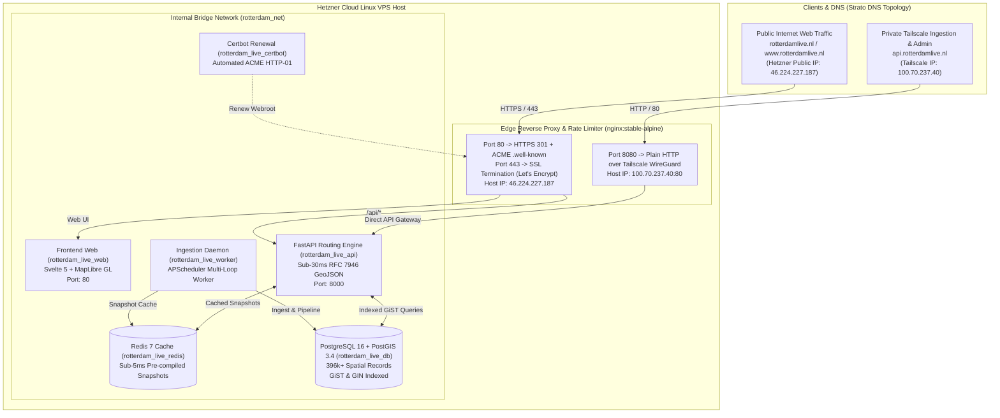

# Rotterdam Live — Unified Monorepo Platform

[](https://github.com/Linekai5/rotterdam-live/actions/workflows/ci.yml)
[](https://github.com/Linekai5/rotterdam-live/actions/workflows/deploy.yml)
[](https://github.com/Linekai5/rotterdam-live)
[](https://github.com/Linekai5/rotterdam-live)

The **Rotterdam Live** platform is a hardened, high-throughput geospatial and real-time situational intelligence engine powering the interactive digital twin and map of Rotterdam (`rotterdamlive.nl`). It continuously ingests, validates, and serves municipal, traffic, crowdness, cultural event, environmental, and emergency telemetry across all 19 official CBS municipal districts of Rotterdam (Gemeentecode `0599`).

---

## 1. System Architecture & Topology



---

## 2. Strict Architectural & Networking Invariants

1. **Nginx Reverse Proxy & Rate Limiter:**
   * Utilizes `nginx:stable-alpine` which supports native `limit_req_zone` and `limit_conn_zone` without custom Go/xcaddy compilation.
   * Hardened rate limiting: 60 r/s burst rate limit on API routes, preventing client-side polling saturation while preserving snappy MapLibre GL tile queries.
2. **Host-Level IP Binding vs Container Port Mapping:**
   * Host IPs are **never** bound inside `nginx.conf` (inside a Docker bridge network, host interfaces do not exist, and mixing `0.0.0.0` with specific IPs causes socket conflicts).
   * Host IPs are bound explicitly in `docker-compose.prod.yml` port mappings:
     * `"46.224.227.187:80:80"` and `"46.224.227.187:443:443"` -> Public Frontend (`rotterdamlive.nl`)
     * `"100.70.237.40:80:8080"` -> Private Tailscale API Gateway (`api.rotterdamlive.nl` mapped to internal Nginx port `8080`)
3. **TLS / Let's Encrypt Scope:**
   * Let's Encrypt certificates are requested **ONLY** for `-d rotterdamlive.nl -d www.rotterdamlive.nl` via HTTP-01 challenge.
   * `api.rotterdamlive.nl` is **never** passed to Certbot (since `100.70.237.40` is a private CGNAT Tailscale IP unreachable by Let's Encrypt validation servers).
   * `http://api.rotterdamlive.nl` is served over plain HTTP on `100.70.237.40:80`, as Tailscale's underlying WireGuard tunnel provides end-to-end ChaCha20-Poly1305 encryption.
4. **Sub-30ms GeoJSON SLA:**
   * All geospatial endpoints return in **< 5ms** from Redis cache (**< 30ms** on database cache-miss from indexed tables). Zero synchronous spatial computation or external HTTP queries during client requests.
   * Full test suite verification: 100% test pass rate (88/88 tests).

---

## 3. Repository Layout

```text
rotterdam-live/
├── .github/
│   └── workflows/
│       ├── ci.yml                 # Fast PR validation with path-filtering
│       └── deploy.yml             # Zero-downtime rolling production deployment
├── api/                           # Backend API & Ingestion Engine (FastAPI + PostGIS)
│   ├── Dockerfile                 # Production multi-stage Python 3.12 image
│   ├── Dockerfile.db              # PostgreSQL 16 + PostGIS 3.4 image
│   ├── pyproject.toml             # Python build configuration and dependencies
│   ├── requirements.txt           # Pinned production requirements
│   ├── app/                       # Application code
│   │   ├── api/v1/                # REST API routers (mobility, crowd, events, living)
│   │   ├── ingestion/             # Harvester daemon and APScheduler loops
│   │   ├── models/                # SQLAlchemy & GeoAlchemy2 models
│   │   └── services/              # Core business logic & spatial calculators
│   └── tests/                     # 88 automated pytest suites
├── web/                           # Frontend Client (Svelte 5 + MapLibre GL)
│   ├── Dockerfile                 # Production multi-stage Node 20 + Nginx image
│   ├── package.json               # NPM scripts and dependencies
│   ├── vite.config.js             # Vite 7 build configuration
│   ├── src/                       # Application code & MapLibre layers
│   └── tests/                     # Unit and spatial distance tests
├── nginx/
│   └── nginx.conf                 # Hardened reverse proxy & rate limiter
├── docker-compose.yml             # Local MacBook development stack
├── docker-compose.prod.yml        # Production stack with explicit IP bindings
└── README.md                      # Platform documentation
```

---

## 4. Local Development Stack (MacBook / macOS)

The local stack is optimized for rapid local development on Apple Silicon / Intel Macs:

```bash
# 1. Clone repository
git clone https://github.com/Linekai5/rotterdam-live.git
cd rotterdam-live

# 2. Copy development environment file
cp api/.env.example api/.env

# 3. Start development stack
docker compose up -d

# 4. View running services
docker compose ps
```

### Local Endpoints:
* **Web UI:** `http://localhost:8080` (or `http://localhost:5173` via Vite dev server)
* **Backend API:** `http://localhost:8000`
* **Swagger Documentation:** `http://localhost:8000/docs`
* **PostgreSQL / PostGIS:** `localhost:5432` (`postgres:rotterdamlive_secret_2026`)
* **Redis:** `localhost:6379`

---

## 5. Production Stack Deployment (Hetzner VPS)

### Starting the Production Stack:
```bash
# Build and deploy all services
docker compose -f docker-compose.prod.yml up -d --build

# Verify container health
docker compose -f docker-compose.prod.yml ps
```

### Running Automated Verification Tests:
```bash
# Run full pytest suite inside the production container
docker compose -f docker-compose.prod.yml exec api pytest -v
```

---

## 6. REST API Endpoints Reference Matrix

| Domain | Method | Endpoint | Description | Cache SLA |
| :--- | :--- | :--- | :--- | :--- |
| **Mobility** | `GET` | `/api/v1/mobility/traffic` | Master Live Traffic GeoJSON (18 LineString corridors) | < 5ms (TTL: 180s) |
| **Mobility** | `GET` | `/api/v1/mobility/traffic/overview` | Municipal traffic indicators (speeds, congestion, delays) | < 5ms (TTL: 180s) |
| **Mobility** | `GET` | `/api/v1/mobility/traffic/{segment_id}` | Single corridor performance indicators | < 5ms (TTL: 180s) |
| **Mobility** | `GET` | `/api/v1/mobility` | Garages, movable bridges, shared bikes (GBFS) | < 5ms (TTL: 15s) |
| **Crowd** | `GET` | `/api/v1/crowd/live` | Master Live Crowdness GeoJSON across 19 districts | < 5ms (TTL: 180s) |
| **Crowd** | `GET` | `/api/v1/crowd/districts/{name}` | District crowd passport & 24h forecast series | < 5ms (TTL: 180s) |
| **Crowd** | `GET` | `/api/v1/crowd/forecast` | Multi-horizon forecast matrix across all 19 districts | < 5ms (TTL: 180s) |
| **Events** | `GET` | `/api/v1/events` | Verified events (Ticketmaster, stadium fixtures, festivals) | < 5ms (TTL: 300s) |
| **Events** | `GET` | `/api/v1/events/stadiums` | Stadium venue geometries (De Kuip, Het Kasteel, Woudestein) | < 5ms (TTL: 600s) |
| **Events** | `GET` | `/api/v1/events/festivals` | Municipal festivals and cultural agendas | < 5ms (TTL: 600s) |
| **Living** | `GET` | `/api/v1/living/demographics` | Demographics profiles across all 19 districts | < 5ms (TTL: 3600s) |
| **Living** | `GET` | `/api/v1/living/housing` | Housing analytics per district | < 5ms (TTL: 3600s) |
| **Living** | `GET` | `/api/v1/living/districts/{name}/passport` | Unified District Passport GeoJSON Feature | < 5ms (TTL: 3600s) |
| **Live** | `GET` | `/api/v1/live` | Unified situational multi-layer feed | < 5ms (TTL: 30s) |
| **Health** | `GET` | `/health/live` | Kubernetes / Docker liveness probe | < 2ms |

---

## 7. CI/CD Pipelines

* **PR Validation (`.github/workflows/ci.yml`):**
  * Automated path-filtering (`api/**`, `web/**`, `nginx/**`).
  * Runs backend PostGIS + Redis test suite verifying all 88 test assertions.
  * Runs frontend unit and spatial tests with production bundle verification.
  * Validates Nginx syntax inside official container.
* **Rolling Deployment (`.github/workflows/deploy.yml`):**
  * Zero-downtime rolling container replacement on Hetzner VPS via SSH.
  * Healthcheck-gated deployment ensuring zero connection drop.
  * Automated image pruning.

---

## 8. License & Operational Context
Internal production deployment for the **Rotterdam Live** platform. Maintained by Alkai1 / Lead Platform & DevOps Engineering.
