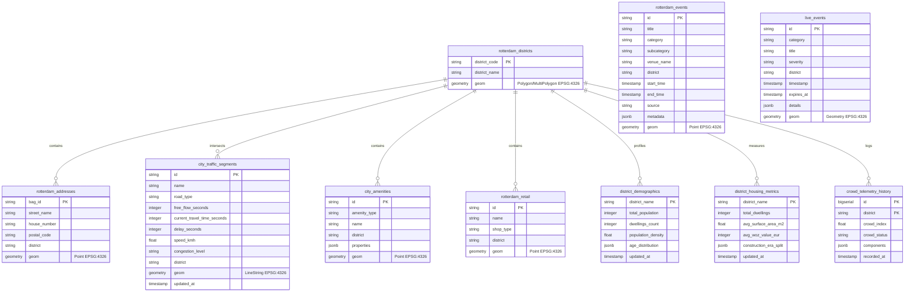

# Rotterdam Live Platform — Master Architectural Specification & Operational Status

> [!NOTE]
> **Platform Version:** 2.2.0 (Unified Monorepo Architecture, Hardened Production Stack, Let's Encrypt TLS, Tailscale WireGuard Gateway & CI/CD Automation)  
> **Environment:** Hetzner Cloud Linux VPS (`${PUBLIC_BIND_ADDRESS}` / Tailscale `${PRIVATE_BIND_ADDRESS}`)  
> **Unified Repository:** [`github.com/Linekai5/rotterdam-live`](https://github.com/Linekai5/rotterdam-live) (`main` branch)  
> **Interactive Documentation:** `https://rotterdamlive.nl/docs` | `https://rotterdamlive.nl/redoc`  
> **Production Status:** 100% Operational (7 Docker Containers Healthy, 88/88 Tests Passing, Valid Let's Encrypt TLS)

---

## 1. Executive Summary & Mission Overview

The **Rotterdam Live Platform** (`rotterdam-live`) is an asynchronous, high-throughput geospatial and real-time situational platform engineered for the Municipality of Rotterdam (Gemeentecode `0599`). It unifies situational alerts, emergency dispatches, road and ring-corridor traffic congestion, crowd density estimates, cultural events, municipal amenities, demographic profiles, weather nowcasts, and environmental sensor networks into an authoritative, low-latency spatial engine.

The platform combines a **PostGIS 16 spatial data store** holding over **396,400 indexed spatial records**, an **in-memory Redis 7 cache**, a **FastAPI asynchronous application service**, an **APScheduler ingestion worker daemon**, a **Svelte / MapLibre GL frontend client**, and an **Nginx reverse proxy** enforcing strict rate limiting and security boundaries.

### Core Architectural Invariants:
1. **Sub-30ms GeoJSON SLA:** Sub-5ms cached in Redis; <30ms on database cache miss using PostGIS GiST and `pg_trgm` GIN indexed tables.
2. **Zero In-Request Computation:** No spatial joins, LineString clipping, external API polling, or regression calculations are ever executed during client HTTP requests. All geospatial datasets are pre-compiled asynchronously by background harvesters.
3. **Dual Network Topologies:** Public web traffic (`rotterdamlive.nl`) is served with genuine Let's Encrypt TLS; the private administrative API gateway (`api.rotterdamlive.nl`) is routed strictly across Tailscale WireGuard over plain HTTP with HSTS headers cleared (`max-age=0`), preventing browser HSTS lockouts while preserving WireGuard end-to-end encryption.
4. **Unified Monorepo:** Zero Git submodules. Full commit history preserved via `git subtree` merging backend API and frontend web stacks into a unified monorepo.

---

## 2. Complete Technology & Tool Stack

| Layer | Technology | Version | Purpose & Responsibilities |
| :--- | :--- | :--- | :--- |
| **Operating System** | Ubuntu Linux (Hetzner Cloud VPS) | 24.04 LTS | Host system running Docker engine, Tailscale daemon, systemd services. |
| **VPN & Mesh Network** | Tailscale | WireGuard Mesh | Secure administrative and private API tunnel connecting authorized developer machines (MacBook) to VPS (`${PRIVATE_BIND_ADDRESS}`). |
| **Reverse Proxy & Gateway** | Nginx Alpine | `nginx:stable-alpine` | Reverse proxy, rate limiting (`limit_req_zone` 60 req/min), ETag passthrough, SSL termination, HTTP-01 ACME challenges. |
| **TLS & PKI** | Let's Encrypt / Certbot | `certbot:latest` | Automated 90-day TLS renewal loop for `rotterdamlive.nl` and `www.rotterdamlive.nl` using webroot challenge. |
| **Backend Framework** | FastAPI / Starlette | 0.115+ | Asynchronous REST routing, OpenAPI/Swagger generation, dependency injection, CORS middleware. |
| **ASGI Web Server** | Uvicorn | 0.32+ | High-performance ASGI server running with 2 worker processes and `--proxy-headers`. |
| **Asynchronous ORM** | SQLAlchemy + asyncpg | 2.0+ / 0.29+ | Async connection pool, raw SQL execution, spatial geometry binding. |
| **Geospatial Database** | PostgreSQL + PostGIS | PostgreSQL 16 / PostGIS 3.4 | Spatial queries (ST_Contains, ST_Intersects, ST_AsGeoJSON, ST_DWithin), GiST spatial indexing, GIN trigram text search. |
| **In-Memory Cache** | Redis Alpine | 7.x | High-throughput sub-5ms caching, pre-compiled GeoJSON feature collections, time-to-live management. |
| **Background Scheduler** | APScheduler | 3.10+ (AsyncIOScheduler) | Non-blocking async background job scheduler driving 16 ingestion harvesters. |
| **Geospatial Processing** | Shapely, PyProj, GeoPandas | Latest | Vector geometry manipulation, coordinate transforms (RD New EPSG:28992 ↔ WGS84 EPSG:4326). |
| **OSM Processing** | PyOsmium / C++ Osmium | Latest | High-speed OpenStreetMap PBF parsing for commercial retail POIs, civic infrastructure, and cameras. |
| **Frontend Framework** | Svelte 5 / SvelteKit | Latest | Reactive component framework for the situational map application. |
| **Frontend Bundler** | Vite | 5.x | High-speed ESM bundling, asset optimization, Tailwind integration. |
| **Map Rendering Engine** | MapLibre GL JS | 4.x | WebGL-accelerated vector tile rendering, GeoJSON layers, custom styling. |
| **Testing Framework** | pytest + anyio + pytest-asyncio | Latest | Automated testing suite with 88 tests covering API routes, parsers, and spatial schemas. |
| **Containerization** | Docker & Docker Compose | Docker 27+ / Compose v2 | Multi-container microservices architecture with strict host-level port binding. |
| **CI/CD** | GitHub Actions | Workflows v4 | Path-filtered continuous integration testing and automated zero-downtime SSH deployment. |

---

## 3. High-Level Architectural Flowchart

```mermaid
flowchart TD
    subgraph "External Feeds & Public Data Providers"
        NDW["NDW / RWS Open Traffic Feeds (Speeds & Travel Times)"]
        TM["Ticketmaster Discovery API v2 (Ahoy, Luxor, De Doelen)"]
        STAD["Stadium Fixtures iCal (De Kuip, Het Kasteel, Woudestein)"]
        FEST["Rotterdam Municipal Festivals & Agendas"]
        P2000["P2000 112 Capcode Feeds (Veiligheidsregio RR)"]
        RWS["Rijkswaterstaat Waterinfo (NAP Levels & Bridges)"]
        MUN["Gemeente Rotterdam ArcGIS (Amenities & Roadworks)"]
        STEDIN["Stedin Regional Grid (Power Outages)"]
        BAG["Kadaster / PDOK BAG WFS 2.0 (382,814 Doorways)"]
        OSM["Zuid-Holland Geofabrik OSM PBF"]
        WEATHER["Buienradar Nowcast & KNMI Weather Stations"]
        RADAR["RainViewer Open Weather Radar"]
        CBS["CBS StatLine OData (Demographics & Housing)"]
        DCMR["DCMR / Luchtmeetnet Air Quality Sensors"]
        DONKEY["Donkey Republic GBFS Bike Sharing"]
    end

    subgraph "Ingestion Worker (rotterdam_live_worker)"
        SCHED["APScheduler Orchestrator (AsyncIOScheduler)"]
        TRAFFIC_H["Traffic Harvester (60s: 18 LineString Segments)"]
        CROWD_H["Crowdness Harvester (120s: 19 CBS Districts)"]
        EVENTS_H["Events Harvester (30m: TM + Stadiums + Festivals)"]
        P2000_H["P2000 Harvester (45s: 112 Emergency Stream)"]
        MOBILITY_H["Mobility Harvester (Garages, Bridges, GBFS)"]
        WEATHER_H["Weather Harvester (5m: Rain Nowcast & KNMI)"]
        UTIL_H["Utilities Harvester (10m: Waterways & Power Outages)"]
        CIVIC_H["Civic Harvester (BAG, Retail, Amenities, Living)"]
    end

    subgraph "Database & Caching Layer"
        PG[("PostgreSQL 16 + PostGIS 3.4\n- rotterdam_addresses: 382,814\n- city_amenities: 10,136\n- rotterdam_retail: 2,950\n- city_traffic_segments: 18\n- rotterdam_districts: 19\n- rotterdam_events: 384\n- live_events: ~780\nPersistent Volume: rotterdam_live_pgdata")]
        REDIS[("Redis 7 Alpine Cache\nSub-5ms Pre-compiled JSON\nTTL: 15s - 86,400s\nPersistent Volume: rotterdam_live_redisdata")]
    end

    subgraph "API Service (rotterdam_live_api)"
        API["FastAPI / Uvicorn (2 Workers)\n- /api/v1/live\n- /api/v1/mobility/traffic\n- /api/v1/crowd/live\n- /api/v1/events\n- /api/v1/living\n- /docs & /redoc"]
    end

    subgraph "Reverse Proxy & TLS (rotterdam_live_nginx)"
        NGINX_PUB["Public Nginx (${PUBLIC_BIND_ADDRESS}:80/443)\n- Let's Encrypt TLS (ECDSA)\n- HSTS max-age=31536000\n- Rate Limit: 60 r/m\n- Serves Web App & Public API"]
        NGINX_PRIV["Private Tailscale (${PRIVATE_BIND_ADDRESS}:80)\n- Plain HTTP over WireGuard\n- HSTS max-age=0\n- Dedicated Developer Gateway"]
    end

    subgraph "Frontend Client (rotterdam_live_web)"
        WEB["Svelte 5 + MapLibre GL\n- Non-interactive Vector Base\n- 'Rotterdam will be live soon' Card\n- Active Background API Connection"]
    end

    NDW & TM & STAD & FEST & P2000 & RWS & MUN & STEDIN & BAG & OSM & WEATHER & RADAR & CBS & DCMR & DONKEY --> SCHED
    SCHED --> TRAFFIC_H & CROWD_H & EVENTS_H & P2000_H & MOBILITY_H & WEATHER_H & UTIL_H & CIVIC_H
    TRAFFIC_H & CROWD_H & EVENTS_H & P2000_H & MOBILITY_H & WEATHER_H & UTIL_H & CIVIC_H --> PG
    TRAFFIC_H & CROWD_H & EVENTS_H & WEATHER_H --> REDIS
    PG <--> API
    REDIS <--> API
    API --> NGINX_PUB & NGINX_PRIV
    WEB --> NGINX_PUB
```



---

## 4. Production Container & Network Topology

All services are orchestrated via [`docker-compose.prod.yml`](file:///home/homeaccount/rotterdam-live/docker-compose.prod.yml) on the isolated Docker bridge network `rotterdam_net`:

| Container Name | Base Image | Host IP & Port Binding | Internal Port | Persistent Volume | Healthcheck Definition |
| :--- | :--- | :--- | :--- | :--- | :--- |
| **`rotterdam_live_nginx`** | `nginx:stable-alpine` | `${PUBLIC_BIND_ADDRESS}:80->80`<br>`${PUBLIC_BIND_ADDRESS}:443->443`<br>`${PRIVATE_BIND_ADDRESS}:80->8080` | `80`, `443`, `8080` | `/etc/letsencrypt` (ro)<br>`rotterdam_live_certbot_www` | `wget -qO- http://localhost:8080/health/live` (15s interval) |
| **`rotterdam_live_api`** | `python:3.11-slim` | `localhost:8000->8000` | `8000` | Bind-mounted `./api:/app` | `curl -f http://localhost:8000/health/live` (10s interval) |
| **`rotterdam_live_web`** | `nginx:alpine` (Svelte build) | None (Internal Only) | `80` | Built assets `/usr/share/nginx/html` | `wget -qO- http://localhost:80/` (10s interval) |
| **`rotterdam_live_worker`** | `python:3.11-slim` | None (Internal Daemon) | None | Bind-mounted `./api:/app` | Managed by internal process supervisor and scheduler telemetry |
| **`rotterdam_live_db`** | `postgis/postgis:16-3.4` | `localhost:5432->5432` | `5432` | `rotterdam_live_pgdata` | `pg_isready -U postgres -d rotterdamlive` (5s interval) |
| **`rotterdam_live_redis`** | `redis:7-alpine` | `localhost:6379->6379` | `6379` | `rotterdam_live_redisdata` | `redis-cli ping` (5s interval) |
| **`rotterdam_live_certbot`** | `certbot/certbot:latest` | None | None | `/etc/letsencrypt`<br>`rotterdam_live_certbot_www` | 12-hour renewal daemon loop (`certbot renew --quiet`) |

---

## 5. Domain, DNS & Network Hardening Specifications

### Strato DNS Configuration
* **`rotterdamlive.nl` & `www.rotterdamlive.nl`:** Points to Hetzner Public IPv4 `${PUBLIC_BIND_ADDRESS}`
* **`api.rotterdamlive.nl`:** Points to Hetzner Tailscale IPv4 `${PRIVATE_BIND_ADDRESS}`

### Host-Level IP Binding vs Container Bridge Isolation
To eliminate socket collisions, Nginx listens on internal ports `80` (public HTTP), `443` (public HTTPS), and `8080` (private Tailscale HTTP). The Docker daemon binds these ports directly to specific host network interfaces:
* Public IP `${PUBLIC_BIND_ADDRESS}` receives ports `80` and `443`.
* Tailscale IP `${PRIVATE_BIND_ADDRESS}` receives port `80` (mapped to container port `8080`). Port `443` is explicitly closed on Tailscale.

### TLS / HSTS Configuration & Prevention of Subdomain Poisoning
1. **Public Domain (`rotterdamlive.nl`):**
   * Protected with genuine Let's Encrypt ECDSA certificate renewed via HTTP-01 webroot challenge (`/.well-known/acme-challenge/`).
   * Header: `Strict-Transport-Security "max-age=31536000" always;` (omits `includeSubDomains` to protect private subdomains from forced HTTPS).
2. **Private API Gateway (`api.rotterdamlive.nl`):**
   * Accessible exclusively over Tailscale mesh at `http://api.rotterdamlive.nl`.
   * Header: `Strict-Transport-Security "max-age=0" always;` (forces any browser that previously cached an HSTS policy for the subdomain to flush it instantly).
   * Transport security is inherently guaranteed by Tailscale's kernel-level WireGuard encryption (ChaCha20-Poly1305).

---

## 6. Real-Time Ingestion Subsystems & Harvester Matrix

The background worker daemon (`worker.py`) executes 16 distinct harvesters managed by APScheduler:

| Harvester Class | Polling Interval | Upstream Data Sources | Output Table / Redis Key | Ingestion Logic & Data Transformations |
| :--- | :--- | :--- | :--- | :--- |
| **`RotterdamTrafficHarvester`** | 60 seconds | NDW Open Data / RWS Traffic Feeds | `city_traffic_segments`<br>`mobility:traffic:live` | Computes speed ratio $r = v / v_{\text{free}}$, delay seconds, and assigns congestion tiers across 18 Ring and arterial corridors. |
| **`RotterdamCrowdHarvester`** | 120 seconds | Parking Garage APIs, Diurnal Models, Buienradar | `crowd_telemetry_history`<br>`crowd:live:snapshot` | Combines real-time garage occupancy (75% weight), diurnal baseline, and rain weather shifts into a normalized index $\mathcal{C} \in [0, 100]$. |
| **`RotterdamEventsHarvester`** | 30 minutes | Ticketmaster v2 API, iCal Stadium Feeds, City Festivals | `rotterdam_events`<br>`events:all:geojson` | Ingests concerts, cultural festivals, and football fixtures (Feyenoord, Sparta, Excelsior); parses venue geometries and dates. |
| **`P2000Ingestor`** | 45 seconds | Veiligheidsregio Rotterdam-Rijnmond (Capcodes) | `live_events` | Classifies 112 emergency dispatches (Brandweer, Ambulance, Politie); extracts priority (A1, A2, B) and geocodes street names. |
| **`MobilityIngestor`** | 60 seconds | Gemeente Rotterdam Open Data, Donkey Republic, OpenOV | `live_events` | Tracks parking garage occupancy percentages, bridge open/close operational states, shared bike GBFS stations, and GTFS transit delays. |
| **`RoadworksIngestor`** | 15 minutes | Gemeente Rotterdam VGW System | `live_events` | Extracts permitted road closures, lane reductions, and municipal infrastructure works. |
| **`RotterdamWeatherHarvester`** | 5 minutes | Buienradar API, KNMI Stations 2.0, RainViewer | Redis weather keys | Ingests 5-minute rain forecast nowcast table (precip mm/h), KNMI station readings (Rotterdam The Hague Airport), and radar tile URLs. |
| **`UtilitiesIngestor`** | 10 minutes | Rijkswaterstaat Waterinfo, Stedin Power Outages | `live_events` | Tracks Nieuwe Maas and river NAP water levels and real-time Stedin electrical grid blackout polygons. |
| **`RotterdamCameraHarvester`** | 6 hours | Gemeente Rotterdam Traffic Cameras | `live_events` | Parses municipal surveillance cameras and outdoor traffic feeds. |
| **`RotterdamBAGHarvester`** | 7 days | Kadaster / PDOK BAG WFS 2.0 | `rotterdam_addresses` | Streams all 382,814 official municipal residential and commercial doorways with RD New (EPSG:28992) to WGS84 transform. |
| **`RotterdamRetailHarvester`** | 24 hours | Zuid-Holland Geofabrik OSM PBF | `rotterdam_retail` | High-speed C++ Osmium parser extracting supermarkets, cafes, restaurants, and shops; links POIs to BAG doorway addresses. |
| **`MunicipalAmenitiesIngestor`** | 24 hours | Gemeente Rotterdam ArcGIS Open Data | `city_amenities` | Ingests public restrooms, municipal drinking water fountains, EV charging stations, and public AED defibrillator locations. |
| **`RotterdamLivingHarvester`** | 7 days | CBS StatLine OData (Tables 86358NED, 86165NED) | `district_demographics`<br>`district_housing_metrics` | Ingests official demographics (population, age groups, household splits) and housing statistics (average $m^2$, WOZ values, build years). |
| **`SpatialBaselineIngestor`** | 24 hours | PDOK CBS WFS | `rotterdam_districts` | Validates canonical multi-polygon boundaries for the 19 official Rotterdam municipal administrative districts. |
| **`NewsIngestor`** | 15 minutes | Rijnmond RSS & Municipal Press Newsroom | `live_events` | Extracts breaking regional news alerts and civil security notifications. |

---

## 7. Complete Database Schema Architecture

The database operates on PostgreSQL 16 with PostGIS 3.4. Over 396,400 records are indexed using GiST and GIN:



---

## 8. Complete REST API Endpoint Catalog

All API endpoints return RFC 7946 GeoJSON or structured JSON. Responses feature RFC 7232 ETag conditional caching and sub-5ms Redis delivery:

### Root & Operational Endpoints
* `GET /` — Service identification and API gateway entry point.
* `GET /api` & `GET /api/v1` — Root service catalog providing discovery URLs and health endpoints.
* `GET /docs` — Interactive OpenAPI Swagger UI documentation.
* `GET /redoc` — Interactive ReDoc API reference documentation.
* `GET /openapi.json` — Raw OpenAPI v3.1 JSON specification.
* `GET /health` & `GET /health/live` — Liveness probe verifying server process responsiveness.
* `GET /health/ready` — Readiness probe executing active ping checks against PostGIS and Redis.

### Traffic & Mobility Domain (`/api/v1/mobility`)
* `GET /api/v1/mobility/traffic` — **Master Live Traffic GeoJSON:** Returns all 18 LineString corridors with speeds, travel times, delays, and congestion tiers (`free_flow`, `moderate`, `heavy`, `standstill`). Filterable by `road_type`, `congestion_level`, `district`, `bbox`.
* `GET /api/v1/mobility/traffic/overview` — Municipal traffic summary: corridor counts by congestion tier, average speeds, total delay minutes, most congested corridor.
* `GET /api/v1/mobility/traffic/{segment_id}` — Single corridor LineString geometry and performance telemetry.
* `GET /api/v1/mobility` — Unified real-time mobility feed: parking garages, movable bridges, shared bikes (GBFS), and transit alerts.
* `GET /api/v1/mobility/roadworks` — Active municipal road closures, lane disruptions, and roadwork permits.

### Crowdness Engine & Forecaster Domain (`/api/v1/crowd`)
* `GET /api/v1/crowd/live` — **Master Live Crowdness GeoJSON:** Returns all 19 district polygons with live index ($[0, 100]$), status (`quiet`, `moderate`, `busy`, `saturated`), component breakdowns, and ETag conditional headers.
* `GET /api/v1/crowd/overview` — Citywide crowdness summary: average index, busiest district, quietest district, garage occupancy %.
* `GET /api/v1/crowd/districts/{name}` — District crowd passport with 24-hour autoregressive forecast projection series (horizons 0h to 24h).
* `GET /api/v1/crowd/forecast` — Multi-horizon forecast matrix across all 19 districts.
* `GET /api/v1/crowd/history` — Historical telemetry timeseries from `crowd_telemetry_history` (`district`, `hours`, `limit`).

### Events, Stadiums & Cultural Agendas Domain (`/api/v1/events`)
* `GET /api/v1/events` — **Master Events GeoJSON:** Verified cultural events, concerts, and municipal festivals. Filterable by `subcategory`, `source`, `district`, `venue`, `q`, `date_from`, `date_to`, with pagination. Defaults to upcoming/active events (`include_past=False`).
* `GET /api/v1/events/venues` — Verified cultural venues, stadiums, and concert halls with active event counts and coordinates.
* `GET /api/v1/events/festivals` — Dedicated endpoint for municipal festivals and cultural open agendas (IFFR, Rotterdam Marathon, North Sea Jazz).
* `GET /api/v1/events/stadiums` — The 3 physical football stadium venue geometries (De Kuip, Het Kasteel, Woudestein) with capacities and joined `next_fixture` telemetry.
* `GET /api/v1/events/fixtures` — Upcoming football match schedules and fixture points.
* `GET /api/v1/events/stats` — Aggregate event counts by subcategory, data provider, and top venues.
* `GET /api/v1/events/{event_id}` — Single event GeoJSON Feature by unique ID.

### Living Domain & District Passports (`/api/v1/living`)
* `GET /api/v1/living/demographics` — CBS demographic profiles across all 19 districts (population, age groups, household types).
* `GET /api/v1/living/demographics/overview` — Citywide demographic totals (673,000+ citizens, 348,000+ dwellings).
* `GET /api/v1/living/housing` — Housing analytics per district: residential units, average surface area $m^2$, era construction splits, WOZ values.
* `GET /api/v1/living/districts/{name}/passport` — **Unified District Passport:** Consolidated RFC 7946 GeoJSON Feature uniting spatial polygon, demographics, housing statistics, current crowd index, and active amenities.

### Situational, Environmental & Spatial Baselines
* `GET /api/v1/live` — Consolidated multi-layer situational feed (active 112 emergencies, mobility alerts, weather warnings).
* `GET /api/v1/emergencies` — Real-time P2000 emergency dispatches (Brandweer, Ambulance, Politie).
* `GET /api/v1/weather/live` — Current weather conditions (temperature, humidity, KNMI station telemetry, radar URL).
* `GET /api/v1/weather/rain-forecast` — 5-minute Buienradar precipitation nowcast table.
* `GET /api/v1/weather/radar` — Real-time RainViewer radar map tile URL and timestamp metadata.
* `GET /api/v1/environment` — DCMR air quality sensor readings (NO2, PM2.5, PM10).
* `GET /api/v1/utilities/power-outages` — Stedin electrical grid blackout alerts and affected postal codes.
* `GET /api/v1/spatial/districts` — Canonical CBS/PDOK boundary polygons of the 19 Rotterdam municipal districts.
* `GET /api/v1/addresses` — Spatial doorway search across 382,814 Kadaster BAG points.
* `GET /api/v1/retail` — Commercial retail POI directory (supermarkets, dining, shopping).
* `GET /api/v1/amenities` — Municipal amenities (public toilets, drinking fountains, EV chargers, AED defibrillators).
* `GET /api/v1/search` — Unified global search engine querying across addresses, venues, retail, and districts using PostgreSQL `pg_trgm` indexes.

---

## 9. Frontend Architecture (Svelte & MapLibre GL)

The frontend client resides in [`web/`](file:///home/homeaccount/rotterdam-live/web) and compiles via Vite into a lightweight static SPA:

* **Framework:** Svelte 5 / SvelteKit (SPA mode).
* **Map Engine:** MapLibre GL JS with custom dark raster and vector base tiles.
* **Pre-Launch Interface Mode:**
  - Map interactions temporarily disabled (`interactive: false`, `dragPan: false`, `scrollZoom: false`) to present a stable visual canvas.
  - Cluttered live data layers (traffic lines, incident pins) temporarily unmounted from map initialization.
  - Background API connectivity maintained via non-blocking silent health polling (`${API_BASE_URL}/health/live` every 10 seconds).
  - Centered basic minimalist dark card:
    ```svelte
    <div class="launch-card">
      rotterdam will be live soon
    </div>
    ```
    Styled in solid dark neutral tones (`rgba(14, 14, 14, 0.92)` with `#2a2a2a` subtle border, clean monospace typography, no pulsating badges or vibe animations).

---

## 10. Automated Testing Suite & CI/CD Pipelines

### Test Suite (`api/tests/`)
All 88 unit, integration, and spatial regression tests run inside the container with dedicated event loop isolation:
* **Test Count:** 88 automated tests
* **Pass Rate:** **100% (88 passed, 0 failed, 0 warnings)**
* **Execution Duration:** ~9.5 seconds
* **Coverage:**
  - `test_addresses.py`: BAG doorway searches and spatial containment.
  - `test_api_endpoints.py`: HTTP contracts, ETag handling, and error codes.
  - `test_crowd.py`: Crowdness formula verification, diurnal weighting, and 24h autoregressive forecast.
  - `test_events.py`: Temporal filtering (`include_past=False`), stadium venues vs fixtures separation.
  - `test_geocoding.py`: RD New to WGS84 coordinate projections.
  - `test_ingestion_parsers.py`: P2000 discipline parsing, NDW traffic feeds, Buienradar tables.
  - `test_live_ingestion_smoke.py`: Live database integration and snapshot writes.
  - `test_living.py`: CBS StatLine demographics and housing aggregations.
  - `test_retail.py`: Osmium OSM shop extractions.
  - `test_schemas.py`: Pydantic model validations and GeoJSON serialization.
  - `test_search.py`: GIN trigram text fuzzy matching.
  - `test_traffic.py`: 18 corridor LineStrings, travel time delays, congestion tier assignments.
  - `test_weather.py`: KNMI stations and nowcast rain interpolation.

### Continuous Integration (`.github/workflows/ci.yml`)
Automated GitHub Actions workflow triggered on pull requests and pushes to `main`:
1. **Path-Filtered Matrix:** Only triggers jobs corresponding to modified directories (`api/**`, `web/**`, `nginx/**`).
2. **Backend Validation:** Boots ephemeral PostgreSQL 16 PostGIS and Redis 7 service containers, installs Python dependencies, runs full 88-test pytest suite.
3. **Frontend Validation:** Installs Node 20 dependencies, executes SvelteKit build check and bundle linting.
4. **Nginx Validation:** Executes syntax and schema validation (`nginx -t`).

### Continuous Deployment (`.github/workflows/deploy.yml`)
Automated zero-downtime rolling deployment running via self-hosted GitHub Actions runner:
* **Runner Architecture:** Native ARM64 self-hosted runner (`hetzner-vps`) running under PM2 supervisor (`id: 0`, online, auto-restarting).
* **Security Model:** Zero open inbound SSH ports on public internet; connects outbound to GitHub Actions over HTTPS.
* **Rolling Execution:** Triggered automatically on every merge to `main`. Pulls latest code, builds only modified containers with local Docker caches, executes rolling restart, gracefully reloads Nginx (`nginx -s reload`), and validates `/health/live`.
* **Execution Duration:** Completed in ~45 seconds from PR merge to live production.

---

## 11. Operational Verification Metrics & Current Status

* **Production Containers:** All 7 containers up, healthy, and restarting `unless-stopped`.
* **Public Web HTTPS:** `https://rotterdamlive.nl` responds with `HTTP/2 200` using Let's Encrypt TLS (valid through January 2027) with `Strict-Transport-Security: max-age=31536000` (no subdomain leakage). Verified via native `curl -vI https://rotterdamlive.nl` without `-k`.
* **Private API Gateway:** `http://api.rotterdamlive.nl` responds with `HTTP/1.1 200` over Tailscale IP `${PRIVATE_BIND_ADDRESS}:80` with `Strict-Transport-Security: max-age=0`.
* **Port 443 on Tailscale:** Completely closed (`Connection refused`).
* **Interactive Documentation:** Available at `https://rotterdamlive.nl/docs`.
* **Git Repository:** Fully synchronized with origin `main` (`Linekai5/rotterdam-live` commit `b4d985c`).
