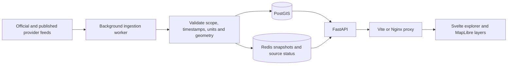

# Rotterdam Live — architecture and data contracts

Architecture review: 16 November 2026. The changes described here are verified locally on `malidev`; production rollout is separate. Data counts are observations from this review, not permanent coverage guarantees.

## Application and services

The public application is a Svelte client using MapLibre GL 6.18. The private backend consists of FastAPI, PostgreSQL/PostGIS, Redis and a background ingestion worker. Nginx serves the built frontend and proxies API requests on the same origin.

| Local service | Address | Role |
| --- | --- | --- |
| Vite | `http://localhost:5173` | Frontend development, with API proxying to port 8000 |
| FastAPI | `http://localhost:8000` | Local API, `/docs`, `/redoc` and `/openapi.json` |
| Built frontend | `http://localhost:8080` | Docker/Nginx preview with the same-origin API proxy |
| PostgreSQL/PostGIS | Docker service `db` | Indexed records, spatial queries and persistent source snapshots |
| Redis | Docker service `redis` | Short-lived query responses, source health and last-good snapshots |
| Ingestion worker | Docker service `ingestion_worker` | Provider retrieval, normalization, reference joins and model computation |

The frontend requests relative `/api/v1/...` and `/health/...` URLs. A production build does not need a browser connection to a development port. The built-preview browser check verifies this behavior.

Backend source, environment files, data dumps and local operational files stay outside the public Git tree. `main` triggers the host's frontend deployment timer; changing `malidev` does not deploy it. The timer archives and builds `web/`, tests it, checks the live weather contract and rolls back a failed activation. Private backend changes need their own backup, migration and controlled rollout. Repository publication and historical-reference limitations are documented in [publication.md](https://github.com/Linekai5/rotterdam-live/blob/main/docs/publication.md).

## Ingestion and request handling

HTTP handlers serve local snapshots and indexed queries. They do not retrieve upstream weather on a cache miss. Weather and traffic return preserved, explicitly stale data where usable, or an unavailable response when no usable snapshot exists. API startup creates/migrates the schema; provider seeding belongs to the worker.

The worker coalesces scheduled jobs and prevents overlapping instances of each scheduled job. Initial seeding can run in the background without blocking shutdown; it can be disabled for a controlled restart after sources were already refreshed. Domain cache invalidation preserves weather snapshots, last-good records and source-status keys. Redis pattern deletion uses cursor-based scanning.

Freshness is separate from HTTP success and from the time the browser received a response:

- `measured_at` or the provider's report time identifies the source observation.
- `ingested_at` identifies local retrieval or normalization.
- `data_status` and `stale` describe availability and age.
- `is_observed` distinguishes observations from model outputs. A measured journey time does not make its derived speed an instantaneous speed-sensor reading.
- Reference datasets such as district polygons are explicitly marked as reference geometry, not observed telemetry.

An HTTP 200 may contain `data_status: unavailable`. For example, an unconfigured power-outage feed returns an unknown outage count, not a claim that there are zero outages. Database/Redis readiness failures return HTTP 503. `/health/sources` reports source state separately from service readiness.

## Source coverage and interpretation

| Domain | Source and treatment | Consumer limit |
| --- | --- | --- |
| Traffic | Current NDW DATEX II v3 journey measurements and normally expected journey times; RWS NWB road geometry | Route speed and path are derived estimates; coverage is the measured routes, not every street |
| Roadworks | Current NDW planning and closure feeds, scoped to Rotterdam | Plans may refer to future works; published works are not a complete survey of every construction site |
| Parking | RDW SPDP dynamic facility data | Availability is shown only where the provider supplies a valid observation; unknown facilities do not receive generated occupancy |
| Bridges | NDW bridge-opening windows | A published opening window is distinguished from an always-open or always-closed assumption |
| Public transport | OpenOV GTFS-RT alerts filtered to RET and active periods | Network-level alerts are not exact incident coordinates |
| Shared bikes | Donkey Republic GBFS | An empty/unavailable feed stays unavailable; no stations are invented |
| News | Rijnmond Rotterdam and OPEN Rotterdam | Locations can describe a street, district or the whole city; a marker is not proof of an exact incident location |
| Emergency reports | Public P2000 dispatch RSS and scoped location lookup | A dispatch report is not confirmation of an incident; unresolved locations are not placed at the city center |
| Weather | Nearby Buienradar/KNMI station observations and a separate 12-node KNMI HARMONIE model through Open-Meteo | The cloud layer is an illustration driven by model values, not live satellite photography |
| Rain radar | Published RainViewer past frames | Unavailable frames preserve usable previous data; future frames are not fabricated |
| Air quality | Luchtmeetnet/DCMR measurements | Missing pollutants remain unknown; calculated indices are identified as calculations |
| Water levels | Latest RWS station measurements with original measurement times and units | Historical readings are not relabeled as live by giving them today's timestamp |
| Events | Club fixture calendars and available Ticketmaster listings | No annually guessed festival dates or prices; wider city-event coverage can be limited |
| Addresses | Kadaster BAG, scoped with the current BRK Rotterdam boundary | Primary-object fallback and complete label-snapshot coverage are reported separately |
| Districts | CBS/PDOK 2026 wijk and buurt reference polygons | The full municipality and the central map silhouette have different extents |
| Amenities/cameras/retail | Municipal and OpenStreetMap directories | Directory locations do not imply live video, live shop status or confirmed accessibility |
| City Pulse | A district model using available context and parking signals | It is not a count or measurement of people and has no demonstrated footfall-accuracy score |

Primary reference services: [BAG OGC API](https://www.pdok.nl/ogc-apis/-/article/basisregistratie-adressen-en-gebouwen-ba-1), [CBS Wijken en Buurten](https://www.pdok.nl/ogc-apis/-/article/cbs-wijken-en-buurten), [RWS NWB](https://api.pdok.nl/rws/nationaal-wegenbestand-wegen/ogc/v1?f=html&lang=en). Source URLs and provenance accompany relevant API records.

### Traffic geometry

NDW itinerary coordinates frequently identify endpoints rather than the intervening road shape. Drawing those coordinates as a straight line produces chords across buildings and water, even when the journey-time observation is valid.

The worker loads a bounded NWB road graph, follows its junction identities and direction rules, and matches each itinerary to a connected path. Matching rejects distant anchors, disconnected junctions, excessive detours and routes that leave the allowed corridor. Reference retrieval is cached separately from live measurements. The review sample matched 752 of 765 routes; unmatched routes remained available as approximate route-start locations.

`geometry_quality`, `geometry_is_inferred`, `geometry_source`, `speed_geometry_basis` and optional `display_geometry` preserve that distinction. The frontend draws matched paths on roads and shows approximate locations for unmatched paths. Journey speed is an estimate from route length divided by reported journey time. NDW's reported normally expected time supplies the delay/congestion comparison. Provenance persists in PostGIS as well as Redis so a cache miss does not discard it.

### Address search and identity

House numbers are parsed separately from street names. Search handles letters/additions, compact or spaced postcodes, town suffixes, numeric street names and deterministic ties. An exact nonexistent number does not silently return other numbers on the street. Both dedicated and global address search use the same matcher.

Current municipality membership comes from the stored BRK `GM0599` polygon, checked locally. Historical BAG identifier prefixes and broad postcode ranges are not treated as proof of current municipality. This includes Hoek van Holland and Rozenburg while excluding addresses outside Rotterdam.

The original `rotterdam_addresses` table is keyed by the BAG object and cannot represent several address labels on one object. The additive `bag_address_labels` snapshot uses nummeraanduiding identities, validates address and object statuses, and includes primary/secondary labels and eligible VBO/standplaats/ligplaats objects. `bag_address_snapshots` records activation. No label snapshot is selected before its full provider pass and coverage checks succeed; a failed or partial import preserves the previous source. Short-lived compressed pages in `bag_source_pages` let a retry reuse completed downloads.

After validated activation, feature IDs identify labels, `nummeraanduiding_id` identifies the number designation, and `address_id`/`bag_object_id` preserve the underlying object reference. Existing VBO detail links resolve to the current primary label where available. Primary VBO records and retail references are retained. Until a label snapshot is activated, the API serves its explicit primary-VBO fallback with `covers_all_registered_addresses: false`.

The complete provider pass succeeded in the disposable database and was then activated locally in one transaction after a fresh backup. The verified snapshot contains 393,501 address labels for 387,215 objects, including 6,286 secondary labels, 6,714 labels in Hoek van Holland and 6,963 in Rozenburg. Dedicated/global search, postcode/town forms, secondary labels, list filters and old object detail links were checked against the activated API. The worker refreshes the complete label snapshot daily; failed refreshes keep the previous active snapshot.

### Boundaries and City Pulse

The validated CBS 2026 municipal reference contains 22 wijk records, including the separate Groot water record, and 92 buurt records. District consumers query the appropriate boundary type; municipality and buurt polygons do not enter wijk-only outputs. A source failure never replaces valid boundaries with rectangular fallback shapes. Dataset code retirements require explicit reference review rather than automatic deletion.

City Pulse combines a time/day/district prior, event and weather terms, contextual signals and available parking observations. Forecasts project the model and decay its residual contribution. The inputs and measurement basis are exposed. No fabricated pedestrians or sensorless garage readings are supplied. Missing persisted scores remain `null`/Unknown in the API and use a neutral map color. The model has not been validated against a citywide pedestrian-count ground truth.

## Frontend map behavior

- The opening camera fits the existing central Rotterdam extent. It allows a modest extra zoom-out and room to pan. Native viewport-aware bounds prevent leaving the usable map; gesture handlers do not recursively snap the camera back.
- The explorer collapses through its own header. Its active layers remain active, and search/keyboard interaction can reopen it. The weather card retains its own collapse control and Rotterdam clock.
- Both Dutch and English interface choices are available and persisted. The layout, positions and restrained color palette are preserved.
- Data layers are requested on demand. Provider totals, loaded records, mapped records and distinct news locations are separate quantities. Truncation explains how many records were loaded.
- Coincident news keeps a numbered group at street zoom. Clicking it opens its real articles; coordinates are not randomly scattered. Records without usable map locations remain readable without a false marker or camera flight.
- District fills, outlines and selections stay below the city mask across Aerial, Night and Atlas. Search results outside the central silhouette remain readable without flying to empty water.
- SVG map glyphs remain distinct by feature type. Layer fades, selection transitions and camera movement respect reduced-motion preferences.
- Weather illustration appears only on Aerial, fades at street zoom and stays separate from observed rain radar. Data markers remain legible above the illustration.
- MapLibre 6.18 uses its bundled worker explicitly; custom ocean/weather renderers accept its projection-matrix contract. WebGL2 is required; unsupported devices receive an accessible error and recovery control.

## API families

The running OpenAPI document is the authority for exact parameters and schemas. The review swept 68 documented GET operations plus the four documentation routes.

| Family | Main routes |
| --- | --- |
| Health | `/health/live`, `/health/ready`, `/health/sources` |
| Unified events | `/api/v1/live`, `/emergencies`, `/news`, `/environment` |
| Mobility | `/api/v1/mobility`, `/mobility/roadworks`, `/mobility/traffic`, traffic overview/detail |
| Spatial | `/api/v1/spatial/districts?district_type=wijk|buurt|gemeente` |
| Addresses/search | `/api/v1/addresses`, search/stats/detail, `/api/v1/search` |
| Amenities | `/api/v1/amenities`, toilets, water taps, EV chargers, AEDs, camera categories/stats |
| Retail | `/api/v1/retail`, supermarkets, stats and venue detail |
| Weather | `/api/v1/weather/live`, grid, rain forecast, radar, stations and station detail |
| Living | `/api/v1/living/demographics`, overview, housing and district passport |
| Agenda | `/api/v1/events`, today, venues, festivals, fixtures, stadiums, stats and detail |
| City Pulse | `/api/v1/crowd/live`, district detail, forecast, history and overview |
| Utilities/water | `/api/v1/utilities/power-outages`, `/api/v1/environment/waterways` |

CSV category/subcategory filters, district aliases, bounded pagination and bbox validation follow their documented contracts. Pagination totals describe all matching records, including requests beyond the last page. Cache keys preserve the exact numeric bbox used by the query. Strong/weak ETags return an empty 304 body when unchanged. Global search excludes inactive directory entries and expired events. Agenda venue/stat totals describe upcoming active listings rather than counting expired records as upcoming.

## Verification and release boundary

Local verification includes isolated backend tests, frontend unit/build checks, browser tests, desktop/mobile screenshots, source outage/last-good cases, map bounds and mask ordering, coincident stories, translated/collapsible controls, safe source text/links and a built-preview same-origin check. Backend tests and source staging use a disposable database and a separate Redis logical database, backed by a restore-tested pre-ingestion backup.

Completed checks: 268 backend tests passed, 23 frontend unit tests passed, the production build passed, and all 43 browser checks passed, including the built-preview API connection check. All 72 GET/documentation smoke requests returned HTTP 200. Availability metadata remains part of interpreting those responses. Fifteen additional local activation checks confirmed the complete address snapshot and its search/detail compatibility.

Public-tree checks enforce the private-source boundary and reject sensitive tracked material. Production dependency auditing reported no production advisories after the MapLibre upgrade; that is a dependency check, not a claim of complete security.

The reviewed private backend is archived separately with a file-hash manifest. Production rollout still requires a backup of production data/source/images, preservation of server-only work, additive schema migration and verification of the private backend and source snapshots before advancing the public frontend through deployment checks. Local verification and a push to `malidev` do not deploy production. Never publish the private backend or reset unknown server work to deploy the frontend.
