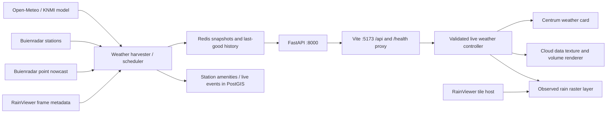

# Rotterdam Live Platform — Master Architectural Specification & Operational Status

> [!NOTE]
> **Architecture Revision:** 2.6.0 — 10 November 2026 (Frontend Design Review, Bespoke SVG Map Symbols, Functional Filter Audit & Source-Backed Camera Directory; application package versions are unchanged)
> **Environment:** Hetzner Cloud Linux VPS (`${PUBLIC_BIND_ADDRESS}` / Tailscale `${PRIVATE_BIND_ADDRESS}`)
> **Unified Repository:** [`github.com/Linekai5/rotterdam-live`](https://github.com/Linekai5/rotterdam-live) (`malidev` development branch; `main` is the deployment branch)
> **Interactive Documentation:** `https://rotterdamlive.nl/docs` | `https://rotterdamlive.nl/redoc`
> **Verification Scope:** Frontend and API changes were implemented and checked locally on ports 5173/8000. They have not been deployed to production in this session. Historical infrastructure figures elsewhere in this document are a platform baseline, not a fresh production audit. See sections 10–14 for validation and limitations.

---

## 1. Executive Summary & Mission Overview

The **Rotterdam Live Platform** (`rotterdam-live`) is an asynchronous, high-throughput geospatial and real-time situational platform engineered for the Municipality of Rotterdam (Gemeentecode `0599`). It unifies situational alerts, emergency dispatches, road and ring-corridor traffic congestion, crowd density estimates, cultural events, municipal amenities, demographic profiles, weather nowcasts, and environmental sensor networks into an authoritative, low-latency spatial engine.

The platform combines a **PostGIS 16 spatial data store** holding over **396,400 indexed spatial records**, an **in-memory Redis 7 cache**, a **FastAPI asynchronous application service**, an **APScheduler ingestion worker daemon**, a **Svelte / MapLibre GL frontend client**, and an **Nginx reverse proxy** enforcing strict rate limiting and security boundaries.

### Core Architectural Invariants:
1. **Cached GeoJSON Performance Target:** Prefer Redis snapshots and indexed PostGIS queries. The historical sub-5ms cache / sub-30ms database figures are targets and prior measurements, not a guarantee for every endpoint or environment.
2. **Background Ingestion First:** Precompute spatial datasets asynchronously. Current weather routes still perform on-demand harvesting on cache misses, including external HTTP calls and station database work; those paths do not meet the cache-hit latency target. Eliminating this exception requires separate work.
3. **Dual Network Topologies:** Public web traffic (`rotterdamlive.nl`) is served with genuine Let's Encrypt TLS; the private administrative API gateway (`api.rotterdamlive.nl`) is routed strictly across Tailscale WireGuard over plain HTTP with HSTS headers cleared (`max-age=0`), preventing browser HSTS lockouts while preserving WireGuard end-to-end encryption.
4. **Unified Monorepo:** Zero Git submodules. Full commit history preserved via `git subtree` merging backend API and frontend web stacks into a unified monorepo.

---

## 2. Complete Technology & Tool Stack

| Layer | Technology | Version | Purpose & Responsibilities |
| :--- | :--- | :--- | :--- |
| **Operating System** | Ubuntu Linux (Hetzner Cloud VPS) | 24.04 LTS | Host system running Docker engine, Tailscale daemon, systemd services. |
| **VPN & Mesh Network** | Tailscale | WireGuard Mesh | Secure administrative and private API tunnel connecting authorized developer machines (MacBook) to VPS (`${PRIVATE_BIND_ADDRESS}`). |
| **Reverse Proxy & Gateway** | Nginx Alpine | `nginx:stable-alpine` | Reverse proxy, rate limiting (`limit_req_zone` 60 req/min), ETag passthrough, SSL termination, HTTP-01 ACME challenges. |
| **TLS & PKI** | Let's Encrypt / Certbot | `certbot:latest` | Automated 90-day TLS renewal loop for `rotterdamlive.nl` and `www.rotterdamlive.nl` using webroot challenge. |
| **Backend Framework** | FastAPI / Starlette | 0.115+ | Asynchronous REST routing, OpenAPI/Swagger generation, dependency injection, CORS middleware. |
| **ASGI Web Server** | Uvicorn | 0.32+ | High-performance ASGI server running with 2 worker processes and `--proxy-headers`. |
| **Asynchronous ORM** | SQLAlchemy + asyncpg | 2.0+ / 0.29+ | Async connection pool, raw SQL execution, spatial geometry binding. |
| **Geospatial Database** | PostgreSQL + PostGIS | PostgreSQL 16 / PostGIS 3.4 | Spatial queries (ST_Contains, ST_Intersects, ST_AsGeoJSON, ST_DWithin), GiST spatial indexing, GIN trigram text search. |
| **In-Memory Cache** | Redis Alpine | 7.x | High-throughput sub-5ms caching, pre-compiled GeoJSON feature collections, time-to-live management. |
| **Background Scheduler** | APScheduler | 3.10+ (AsyncIOScheduler) | Non-blocking async background job scheduler driving 16 ingestion harvesters. |
| **Geospatial Processing** | Shapely, PyProj, GeoPandas | Latest | Vector geometry manipulation, coordinate transforms (RD New EPSG:28992 ↔ WGS84 EPSG:4326). |
| **OSM Processing** | PyOsmium / C++ Osmium | Latest | High-speed OpenStreetMap PBF parsing for commercial retail POIs, civic infrastructure, and cameras. |
| **Frontend Framework** | Svelte | 5.x | Reactive single-page map application; this client does not use SvelteKit. |
| **Frontend Bundler** | Vite | 7.x | ESM development server, API proxy, and production asset bundling. |
| **Map Rendering Engine** | MapLibre GL JS | 2.x (`^2.4.0` in `web/package.json`) | Vector/raster tiles and custom WebGL weather and ocean layers. |
| **Testing Framework** | pytest, Node test runner, Playwright | Repository dependencies | Backend contracts, spatial geometry, controller freshness, and browser-rendered weather regression checks. |
| **Containerization** | Docker & Docker Compose | Docker 27+ / Compose v2 | Multi-container microservices architecture with strict host-level port binding. |
| **CI/CD** | GitHub Actions | Workflows v4 | Path-filtered continuous integration testing and automated zero-downtime SSH deployment. |

---

## 3. High-Level Architectural Flowchart

```mermaid
flowchart TD
    subgraph "External Feeds & Public Data Providers"
        NDW["NDW / RWS Open Traffic Feeds (Speeds & Travel Times)"]
        TM["Ticketmaster Discovery API v2 (Ahoy, Luxor, De Doelen)"]
        STAD["Stadium Fixtures iCal (De Kuip, Het Kasteel, Woudestein)"]
        FEST["Rotterdam Municipal Festivals & Agendas"]
        P2000["P2000 112 Capcode Feeds (Veiligheidsregio RR)"]
        RWS["Rijkswaterstaat Waterinfo (NAP Levels & Bridges)"]
        MUN["Gemeente Rotterdam ArcGIS (Amenities & Roadworks)"]
        STEDIN["Stedin Regional Grid (Power Outages)"]
        BAG["Kadaster / PDOK BAG WFS 2.0 (382,814 Doorways)"]
        OSM["Zuid-Holland Geofabrik OSM PBF"]
        WEATHER["KNMI HARMONIE-AROME, Open-Meteo & Buienradar"]
        RADAR["RainViewer Open Weather Radar"]
        CBS["CBS StatLine OData (Demographics & Housing)"]
        DCMR["DCMR / Luchtmeetnet Air Quality Sensors"]
        DONKEY["Donkey Republic GBFS Bike Sharing"]
    end

    subgraph "Ingestion Worker (rotterdam_live_worker)"
        SCHED["APScheduler Orchestrator (AsyncIOScheduler)"]
        TRAFFIC_H["Traffic Harvester (60s: 18 LineString Segments)"]
        CROWD_H["Crowdness Harvester (120s: 19 CBS Districts)"]
        EVENTS_H["Events Harvester (30m: TM + Stadiums + Festivals)"]
        P2000_H["P2000 Harvester (45s: 112 Emergency Stream)"]
        MOBILITY_H["Mobility Harvester (Garages, Bridges, GBFS)"]
        WEATHER_H["Weather Harvester (Grid: 120s; Rain/Radar: 5m; Stations: 10m)"]
        UTIL_H["Utilities Harvester (10m: Waterways & Power Outages)"]
        CIVIC_H["Civic Harvester (BAG, Retail, Amenities, Living)"]
    end

    subgraph "Database & Caching Layer"
        PG[("PostgreSQL 16 + PostGIS 3.4\n- rotterdam_addresses: 382,814\n- city_amenities: 10,136\n- rotterdam_retail: 2,950\n- city_traffic_segments: 18\n- rotterdam_districts: 19\n- rotterdam_events: 384\n- live_events: ~780\nPersistent Volume: rotterdam_live_pgdata")]
        REDIS[("Redis 7 Alpine Cache\nSub-5ms Pre-compiled JSON\nTTL: 15s - 86,400s\nPersistent Volume: rotterdam_live_redisdata")]
    end

    subgraph "API Service (rotterdam_live_api)"
        API["FastAPI / Uvicorn (2 Workers)\n- /api/v1/live\n- /api/v1/weather/grid\n- /api/v1/mobility/traffic\n- /api/v1/crowd/live\n- /api/v1/events\n- /api/v1/living\n- /docs & /redoc"]
    end

    subgraph "Reverse Proxy & TLS (rotterdam_live_nginx)"
        NGINX_PUB["Public Nginx (${PUBLIC_BIND_ADDRESS}:80/443)\n- Let's Encrypt TLS (ECDSA)\n- HSTS max-age=31536000\n- Rate Limit: 60 r/m\n- Serves Web App & Public API"]
        NGINX_PRIV["Private Tailscale (${PRIVATE_BIND_ADDRESS}:80)\n- Plain HTTP over WireGuard\n- HSTS max-age=0\n- Dedicated Developer Gateway"]
    end

    subgraph "Frontend Client (rotterdam_live_web)"
        WEB["Svelte 5 + MapLibre GL\n- On-Demand City Explorer & Search\n- Optional Clustered Data Layers\n- Live Weather & Optional Observed Rain Radar"]
    end

    NDW & TM & STAD & FEST & P2000 & RWS & MUN & STEDIN & BAG & OSM & WEATHER & RADAR & CBS & DCMR & DONKEY --> SCHED
    SCHED --> TRAFFIC_H & CROWD_H & EVENTS_H & P2000_H & MOBILITY_H & WEATHER_H & UTIL_H & CIVIC_H
    TRAFFIC_H & CROWD_H & EVENTS_H & P2000_H & MOBILITY_H & WEATHER_H & UTIL_H & CIVIC_H --> PG
    TRAFFIC_H & CROWD_H & EVENTS_H & WEATHER_H --> REDIS
    PG <--> API
    REDIS <--> API
    API --> NGINX_PUB & NGINX_PRIV
    WEB --> NGINX_PUB
```

---

## 4. Production Container & Network Topology

All services are orchestrated via `docker-compose.prod.yml` on the isolated Docker bridge network `rotterdam_net`:

| Container Name | Base Image | Host IP & Port Binding | Internal Port | Persistent Volume | Healthcheck Definition |
| :--- | :--- | :--- | :--- | :--- | :--- |
| **`rotterdam_live_nginx`** | `nginx:stable-alpine` | `${PUBLIC_BIND_ADDRESS}:80->80` `${PUBLIC_BIND_ADDRESS}:443->443` `${PRIVATE_BIND_ADDRESS}:80->8080` | `80`, `443`, `8080` | `/etc/letsencrypt` (ro) `rotterdam_live_certbot_www` | `wget -qO- http://localhost:8080/health/live` (15s interval) |
| **`rotterdam_live_api`** | `python:3.12-slim` | `localhost:8000->8000` | `8000` | Bind-mounted `./api:/app` | `curl -f http://localhost:8000/health/live` (10s interval) |
| **`rotterdam_live_web`** | `nginx:alpine` (Svelte build) | None (Internal Only) | `80` | Built assets `/usr/share/nginx/html` | `wget -qO- http://localhost:80/` (10s interval) |
| **`rotterdam_live_worker`** | `python:3.12-slim` | None (Internal Daemon) | None | Bind-mounted `./api:/app` | Managed by internal process supervisor and scheduler telemetry |
| **`rotterdam_live_db`** | `postgis/postgis:16-3.4` | `localhost:5432->5432` | `5432` | `rotterdam_live_pgdata` | `pg_isready -U postgres -d rotterdamlive` (5s interval) |
| **`rotterdam_live_redis`** | `redis:7-alpine` | `localhost:6379->6379` | `6379` | `rotterdam_live_redisdata` | `redis-cli ping` (5s interval) |
| **`rotterdam_live_certbot`** | `certbot/certbot:latest` | None | None | `/etc/letsencrypt` `rotterdam_live_certbot_www` | 12-hour renewal daemon loop (`certbot renew --quiet`) |

---

## 5. Domain, DNS & Network Hardening Specifications

### Strato DNS Configuration
* **`rotterdamlive.nl` & `www.rotterdamlive.nl`:** Points to Hetzner Public IPv4 `${PUBLIC_BIND_ADDRESS}`
* **`api.rotterdamlive.nl`:** Points to Hetzner Tailscale IPv4 `${PRIVATE_BIND_ADDRESS}`

### Host-Level IP Binding vs Container Bridge Isolation
To eliminate socket collisions, Nginx listens on internal ports `80` (public HTTP), `443` (public HTTPS), and `8080` (private Tailscale HTTP). The Docker daemon binds these ports directly to specific host network interfaces:
* Public IP `${PUBLIC_BIND_ADDRESS}` receives ports `80` and `443`.
* Tailscale IP `${PRIVATE_BIND_ADDRESS}` receives port `80` (mapped to container port `8080`). Port `443` is explicitly closed on Tailscale.

### TLS / HSTS Configuration & Prevention of Subdomain Poisoning
1. **Public Domain (`rotterdamlive.nl`):**
   * Protected with genuine Let's Encrypt ECDSA certificate renewed via HTTP-01 webroot challenge (`/.well-known/acme-challenge/`).
   * Header: `Strict-Transport-Security "max-age=31536000" always;` (omits `includeSubDomains` to protect private subdomains from forced HTTPS).
2. **Private API Gateway (`api.rotterdamlive.nl`):**
   * Accessible exclusively over Tailscale mesh at `http://api.rotterdamlive.nl`.
   * Header: `Strict-Transport-Security "max-age=0" always;` (forces any browser that previously cached an HSTS policy for the subdomain to flush it instantly).
   * Transport security is inherently guaranteed by Tailscale's kernel-level WireGuard encryption (ChaCha20-Poly1305).

---

## 6. Real-Time Ingestion Subsystems & Harvester Matrix

The background worker daemon (`worker.py`) executes 16 distinct harvesters managed by APScheduler:

| Harvester Class | Polling Interval | Upstream Data Sources | Output Table / Redis Key | Ingestion Logic & Data Transformations |
| :--- | :--- | :--- | :--- | :--- |
| **`RotterdamTrafficHarvester`** | 60 seconds | NDW Open Data / RWS Traffic Feeds | `city_traffic_segments` `mobility:traffic:live` | Computes speed ratio $r = v / v_{\text{free}}$, delay seconds, and assigns congestion tiers across 18 Ring and arterial corridors. |
| **`RotterdamCrowdHarvester`** | 120 seconds | Parking Garage APIs, Diurnal Models, Buienradar | `crowd_telemetry_history` `crowd:live:snapshot` | Combines real-time garage occupancy (75% weight), diurnal baseline, and rain weather shifts into a normalized index $\mathcal{C} \in [0, 100]$. |
| **`RotterdamEventsHarvester`** | 30 minutes | Ticketmaster v2 API, iCal Stadium Feeds, City Festivals | `rotterdam_events` `events:all:geojson` | Ingests concerts, cultural festivals, and football fixtures (Feyenoord, Sparta, Excelsior); parses venue geometries and dates. |
| **`P2000Ingestor`** | 45 seconds | Veiligheidsregio Rotterdam-Rijnmond (Capcodes) | `live_events` | Classifies 112 emergency dispatches (Brandweer, Ambulance, Politie); extracts priority (A1, A2, B) and geocodes street names. |
| **`MobilityIngestor`** | 60 seconds | Gemeente Rotterdam Open Data, Donkey Republic, OpenOV | `live_events` | Tracks parking garage occupancy percentages, bridge open/close operational states, shared bike GBFS stations, and GTFS transit delays. |
| **`RoadworksIngestor`** | 15 minutes | Gemeente Rotterdam VGW System | `live_events` | Extracts permitted road closures, lane reductions, and municipal infrastructure works. |
| **`RotterdamWeatherHarvester`** | Grid: 120 seconds; rain nowcast/radar: 5 minutes; stations: 10 minutes | Open-Meteo `knmi_seamless`, Buienradar station and raintext feeds, RainViewer | `weather:spatial:grid` `weather:live:rotterdam` `weather:stations:all` `weather:radar:frames` | Validates the existing 12-point mesh, normalizes accumulation amounts to hourly rates, preserves source times and zero readings, and retains labelled last-good snapshots during provider failures. Stations also update PostGIS amenities/live events. See section 12 for contracts, cache keys, and renderer limits. |
| **`UtilitiesIngestor`** | 10 minutes | Rijkswaterstaat Waterinfo, Stedin Power Outages | `live_events` | Tracks Nieuwe Maas and river NAP water levels and real-time Stedin electrical grid blackout polygons. |
| **`RotterdamCameraHarvester`** | 6 hours | Gemeente Rotterdam Traffic Cameras | `live_events` | Parses municipal surveillance cameras and outdoor traffic feeds. |
| **`RotterdamBAGHarvester`** | 7 days | Kadaster / PDOK BAG WFS 2.0 | `rotterdam_addresses` | Streams all 382,814 official municipal residential and commercial doorways with RD New (EPSG:28992) to WGS84 transform. |
| **`RotterdamRetailHarvester`** | 24 hours | Zuid-Holland Geofabrik OSM PBF | `rotterdam_retail` | High-speed C++ Osmium parser extracting supermarkets, cafes, restaurants, and shops; links POIs to BAG doorway addresses. |
| **`MunicipalAmenitiesIngestor`** | 24 hours | Gemeente Rotterdam ArcGIS Open Data | `city_amenities` | Ingests public restrooms, municipal drinking water fountains, EV charging stations, and public AED defibrillator locations. |
| **`RotterdamLivingHarvester`** | 7 days | CBS StatLine OData (Tables 86358NED, 86165NED) | `district_demographics` `district_housing_metrics` | Ingests official demographics (population, age groups, household splits) and housing statistics (average $m^2$, WOZ values, build years). |
| **`SpatialBaselineIngestor`** | 24 hours | PDOK CBS WFS | `rotterdam_districts` | Validates canonical multi-polygon boundaries for the 19 official Rotterdam municipal administrative districts. |
| **`NewsIngestor`** | 15 minutes | Rijnmond RSS & Municipal Press Newsroom | `live_events` | Extracts breaking regional news alerts and civil security notifications. |

---

## 7. Complete Database Schema Architecture

The database operates on PostgreSQL 16 with PostGIS 3.4. Over 396,400 records are indexed using GiST and GIN:

---

## 8. Complete REST API Endpoint Catalog

API endpoints return RFC 7946 GeoJSON or structured JSON. ETag support and latency depend on the route; the weather routes use Redis snapshots but do not implement their own ETag/304 contract:

### Root & Operational Endpoints
* `GET /` — Service identification and API gateway entry point.
* `GET /api` & `GET /api/v1` — Root service catalog providing discovery URLs and health endpoints.
* `GET /docs` — Interactive OpenAPI Swagger UI documentation.
* `GET /redoc` — Interactive ReDoc API reference documentation.
* `GET /openapi.json` — Raw OpenAPI v3.1 JSON specification.
* `GET /health` & `GET /health/live` — Liveness probe verifying server process responsiveness.
* `GET /health/ready` — Readiness probe executing active ping checks against PostGIS and Redis.

### Traffic & Mobility Domain (`/api/v1/mobility`)
* `GET /api/v1/mobility/traffic` — **Master Live Traffic GeoJSON:** Returns all 18 LineString corridors with speeds, travel times, delays, and congestion tiers (`free_flow`, `moderate`, `heavy`, `standstill`). Filterable by `road_type`, `congestion_level`, `district`, `bbox`.
* `GET /api/v1/mobility/traffic/overview` — Municipal traffic summary: corridor counts by congestion tier, average speeds, total delay minutes, most congested corridor.
* `GET /api/v1/mobility/traffic/{segment_id}` — Single corridor LineString geometry and performance telemetry.
* `GET /api/v1/mobility` — Unified real-time mobility feed: parking garages, movable bridges, shared bikes (GBFS), and transit alerts.
* `GET /api/v1/mobility/roadworks` — Active municipal road closures, lane disruptions, and roadwork permits.

### Crowdness Engine & Forecaster Domain (`/api/v1/crowd`)
* `GET /api/v1/crowd/live` — **Master Live Crowdness GeoJSON:** Returns all 19 district polygons with live index ($[0, 100]$), status (`quiet`, `moderate`, `busy`, `saturated`), component breakdowns, and ETag conditional headers.
* `GET /api/v1/crowd/overview` — Citywide crowdness summary: average index, busiest district, quietest district, garage occupancy %.
* `GET /api/v1/crowd/districts/{name}` — District crowd passport with 24-hour autoregressive forecast projection series (horizons 0h to 24h).
* `GET /api/v1/crowd/forecast` — Multi-horizon forecast matrix across all 19 districts.
* `GET /api/v1/crowd/history` — Historical telemetry timeseries from `crowd_telemetry_history` (`district`, `hours`, `limit`).

### Events, Stadiums & Cultural Agendas Domain (`/api/v1/events`)
* `GET /api/v1/events` — **Master Events GeoJSON:** Verified cultural events, concerts, and municipal festivals. Filterable by `subcategory`, `source`, `district`, `venue`, `q`, `date_from`, `date_to`, with pagination. Defaults to upcoming/active events (`include_past=False`).
* `GET /api/v1/events/venues` — Verified cultural venues, stadiums, and concert halls with active event counts and coordinates.
* `GET /api/v1/events/festivals` — Dedicated endpoint for municipal festivals and cultural open agendas (IFFR, Rotterdam Marathon, North Sea Jazz).
* `GET /api/v1/events/stadiums` — The 3 physical football stadium venue geometries (De Kuip, Het Kasteel, Woudestein) with capacities and joined `next_fixture` telemetry.
* `GET /api/v1/events/fixtures` — Upcoming football match schedules and fixture points.
* `GET /api/v1/events/stats` — Aggregate event counts by subcategory, data provider, and top venues.
* `GET /api/v1/events/{event_id}` — Single event GeoJSON Feature by unique ID.

### Living Domain & District Passports (`/api/v1/living`)
* `GET /api/v1/living/demographics` — CBS demographic profiles across all 19 districts (population, age groups, household types).
* `GET /api/v1/living/demographics/overview` — Citywide demographic totals (673,000+ citizens, 348,000+ dwellings).
* `GET /api/v1/living/housing` — Housing analytics per district: residential units, average surface area $m^2$, era construction splits, WOZ values.
* `GET /api/v1/living/districts/{name}/passport` — **Unified District Passport:** Consolidated RFC 7946 GeoJSON Feature uniting spatial polygon, demographics, housing statistics, current crowd index, and active amenities.

### Situational, Environmental & Spatial Baselines
* `GET /api/v1/live` — Consolidated multi-layer situational feed (active 112 emergencies, mobility alerts, weather warnings).
* `GET /api/v1/emergencies` — Real-time P2000 emergency dispatches (Brandweer, Ambulance, Politie).
* `GET /api/v1/weather/live` — Unified station/model overview with `grid_nodes`, GeoJSON features, solar data, `source`, `data_status`, and `observed_at`. The map HUD reads the Centrum grid node rather than the station-preferred top-level summary. Returns labelled stale history or HTTP 503 when no usable weather is available.
* `GET /api/v1/weather/grid` — Existing 12-point KNMI model sample mesh with low/middle/high/total cloud cover, normalized precipitation rates, wind vectors, solar data, and model-derived flags. Sampling/interpolation does not add observed neighbourhood detail.
* `GET /api/v1/weather/stations` — Buienradar-distributed KNMI station observations with source timestamps, returned as GeoJSON.
* `GET /api/v1/weather/stations/{station_id}` — A single station (6344 airport, 6330 Hoek van Holland, 6343 Geulhaven), or HTTP 404 if unavailable.
* `GET /api/v1/weather/rain-forecast` — Approximately two hours of five-minute Buienradar point predictions, with UTC `valid_at` per slot and `status` of `fresh`, `stale`, or `unavailable`; missing rain information is not a dry forecast.
* `GET /api/v1/weather/radar` — RainViewer frame metadata/tile URLs. `latest_frame` is selected from past radar frames only. The frontend displays the latest observed frame; it does not animate a forecast timeline.
* `GET /api/v1/environment` — DCMR air quality sensor readings (NO2, PM2.5, PM10).
* `GET /api/v1/utilities/power-outages` — Stedin electrical grid blackout alerts and affected postal codes.
* `GET /api/v1/spatial/districts` — Canonical CBS/PDOK boundary polygons of the 19 Rotterdam municipal districts.
* `GET /api/v1/addresses` — Spatial doorway search across 382,814 Kadaster BAG points.
* `GET /api/v1/retail` — Commercial retail POI directory (supermarkets, dining, shopping).
* `GET /api/v1/amenities` — Municipal amenities (public toilets, drinking fountains, EV chargers, AED defibrillators).
* `GET /api/v1/search` — Unified global search engine querying across addresses, venues, retail, and districts using PostgreSQL `pg_trgm` indexes.

---

## 9. Frontend Architecture (Svelte 5, City Explorer, MapLibre GL & WebGL Weather)

The `web/` Svelte 5 SPA is bundled by Vite 7. `App.svelte` mounts `MapComponent.svelte`, which initializes MapLibre, the existing ocean/camera layers, the weather controller, `WeatherHud.svelte`, and `CityExplorer.svelte`. The explorer replaces the former layer-control UI in the mounted application. It starts with every optional dataset off; the live weather card and model atmosphere remain independent. No AI supervisor is mounted or requested.

* **City Explorer:** A charcoal panel with muted sage, sand and clay accents provides Map layers, In view and Map sections. Desktop users can collapse it without disabling selected layers; mobile users get a bottom sheet and a separate location sheet. Search, result counts, individual retry controls, selected-layer chips, clear-all and source-specific details make the map usable without loading every dataset. See section 13 for endpoints and request controls.
* **Appearance & Motion:** Aerial, Night and Atlas base maps retain selected overlays, labels and building preferences during style changes. Panels, source opacity and camera movements use short transitions. The operating system's reduced-motion preference disables these transitions, elastic snap animation and idle cloud animation. These controls do not introduce weather presets.

* **Existing Map Behaviour:** Satellite/vector styles, pan, zoom, pitch to 65°, bearing rotation, responsive minimum zoom, and elastic island boundary behaviour remain in `map.js`, `cameraPhysics.js`, and the ocean modules. Those systems predate this session.
* **Cloud Layer:** `weatherEngine.js` installs the custom layer `rotterdam-volumetric-weather`. It interpolates the existing 12-node model data, samples two continuous 3D density fields, traces solar illumination through them, and composites cloud colour/opacity over the map. The lower deck combines low/middle cover; the upper deck uses high cover. See section 12.5 for the precise approximation.
* **Observed Rain Layer:** `live-rain-radar` is a separate MapLibre raster source/layer using the latest past RainViewer frame. It starts off and requests metadata/tiles only after Rain radar is enabled in Map. It has its own frame age checks and can remain available when model weather is stale.
* **Weather Card:** A compact charcoal card shows Centrum temperature, condition, wind, cloud cover, model rain rate, status, and valid time. Its expandable details explain the source and the difference between model values and radar. Muted colours, visible attribution, and responsive sizing replace the previous pill/simulator drawer. There are no weather presets or simulator selection methods.
* **Polling:** Model weather is fetched on initialization and every 60 seconds; radar metadata follows that cadence only while enabled. Both have independent 15-second timeouts and overlap guards. Selected explorer datasets refresh every minute while the document is visible, and when it becomes visible again. Health is polled every 10 seconds with an 8-second timeout; that ping is not a weather freshness check or a guarantee that every feed is available.
* **Local Connection:** In Vite development, the default API base is the page origin. `/api` and `/health` are proxied from port 5173 to `http://localhost:8000`. This works from `localhost:5173` and `localhost:5173`. `VITE_API_BASE_URL` can override the default and may require CORS configuration. Production public requests use the existing Nginx `/api` gateway.
* **Rendering Cost:** The offscreen buffer is at most half the drawing-buffer resolution, capped at a 920-pixel long edge while stationary and 640 during movement. A 33ms timer schedules idle repaint requests unless reduced motion is enabled. A prior short local headless Chrome sample measured about 30 browser frames/second; 60 FPS and mobile performance are not guaranteed. Clouds render beneath explorer overlays so selected markers and corridors remain readable. Custom-layer ordering is guarded against recursive MapLibre style events.

---

## 10. Automated Testing Suite & CI/CD Pipelines

### Latest Full Checks — 10 November 2026

| Check | Result | Scope |
| :--- | :--- | :--- |
| Full backend `python -m pytest -q` in `rotterdam_dev_api` | 111 passed | Includes source-backed camera ingestion, filter/retirement contracts, bbox validation and district source joins. |
| Frontend `npm --prefix web test` | 14 passed | Geometry/weather, request concurrency, source races, SVG sprite lifecycle and getter-backed map selection. |
| Browser suite with `WEB_PREVIEW_ORIGIN=http://localhost:8080` | 23 passed | Vite workflows plus an actual built Docker preview checking same-origin API traffic; includes rendered glyphs, style restoration, mobile and clouds. |
| Vite build / local Docker web build | Passed | Local preview updated on 8080; Nginx forwards API/health requests to FastAPI. |
| Live frontend audit | All 13 layers loaded | No optional startup requests, no captured API HTTP failures or uncaught page errors; no mobile horizontal overflow. |

Screenshots, review notes and exact commands: `docs/artifacts/frontend-review/README.md`. These results establish software behaviour in the local stack, not upstream data accuracy or a production deployment.

### Frontend Explorer Checks — 5 November 2026

| Command / check | Recorded result | What it establishes |
| :--- | :--- | :--- |
| `npm --prefix web test` | 10 passed | Existing ocean/weather checks plus data normalization, safe links, zero/false values, lazy loading, two-request concurrency, cancellation, filter races and style restoration. |
| `npm --prefix web run test:browser` | 18 passed | Ten explorer workflows, seven ocean/imagery/lifecycle checks, and the cloud shader/framebuffer regression. Includes mobile navigation, clusters, optional radar, source errors, keyboard access and reduced motion. |
| `npm --prefix web run build` | Passed | Production Svelte/Vite bundle builds. |
| Local API / visual review | Completed at 5173 → 8000 | Actual event, mobility, crowd, directory and district-profile formats inspected; desktop/mobile layouts reviewed. Optional datasets and radar are absent from initial browser requests. |

No backend code changed for the original 5 November explorer. The latest 10 November API fixes and checks are recorded in section 14. Browser fixtures verify deterministic software behaviour; local live-feed checks do not certify upstream accuracy or continuous availability.

### Weather Session Checks — 28 October 2026

| Command / check | Recorded result | What it establishes |
| :--- | :--- | :--- |
| `docker exec rotterdam_dev_api python -m pytest tests/test_weather.py tests/test_crowd.py -q` | 32 passed | Relevant backend contracts, precipitation interval conversion, calm/north zero values, unavailable rain, preserved timestamps on outage, and HTTP 503 without data/history. |
| `npm --prefix web test` | 6 passed | Existing ocean/camera geometry plus weather interpolation and controller rejection of legacy, invalid, and stale snapshots; no preset API. |
| `npm --prefix web run test:browser -- weather.spec.js` | 1 passed after final renderer changes | A deterministic 82% high-cloud fixture compiles the GLSL program and produces framebuffer pixels containing cloud bodies and clear gaps, rather than only registering a layer. |
| `npm --prefix web run build` | Passed after final renderer changes | Svelte/Vite production bundle builds. |
| Browser inspection | Completed | Local API connection, radar/cloud attachment, absence of presets, desktop/mobile layout, and screenshots from overhead and tilted camera views. |

These are scoped local results, not a claim that the entire backend or browser suite was rerun, that all devices achieve the same frame rate, or that the forecasts have been meteorologically validated. The older 88-test/5-test figures were historical and are not the current session result.

`web/tests/browser/ocean.spec.js` remains the existing geometry/lifecycle browser suite. The weather regression is in `web/tests/browser/weather.spec.js`; the controller regression is in `web/tests/weather.test.mjs`. Test weather fixtures are confined to tests and are not selectable in the application.

### Continuous Integration (`.github/workflows/ci.yml`)
Automated GitHub Actions workflow triggered on pull requests and pushes to `main`:
1. **Path-Filtered Matrix:** Only triggers jobs corresponding to modified directories (`api/**`, `web/**`, `nginx/**`).
2. **Backend Validation:** Boots PostgreSQL/PostGIS and Redis service containers, initializes/seeds the database, and runs the backend pytest suite using Python 3.12.
3. **Frontend Validation:** Installs Node 20 dependencies, runs `npm test`, and builds the Svelte/Vite bundle. The workflow currently does not run Playwright, including the new shader regression; that browser check was run locally.
4. **Nginx Validation:** Executes syntax and schema validation (`nginx -t`).

### Continuous Deployment (`.github/workflows/deploy.yml`)
The workflow is triggered by a push to `main` or manual dispatch and selects a self-hosted runner labelled `self-hosted, rotterdam-vps`. It fetches `main`, builds the production Compose images, recreates API/web/worker services in order, reloads or starts Nginx, and checks health. The workflow name says "zero-downtime", but it does not establish a measured zero-downtime guarantee. This session did not modify or run it. A push to `malidev` does not trigger the automatic production deployment.

---

## 11. Operational Verification Metrics & Current Status

* **Development Branch:** `malidev`. All seven pre-session weather/map commits from the former feature branch were carried forward by ancestry-preserving branch alignment, followed by the session changes. No changes were merged into `main`.
* **Local Runtime:** Vite on 5173; FastAPI on 8000; local Docker API, worker, PostGIS and Redis. The worker was restarted so it stopped rewriting caches using the old ingestion code.
* **Local Verification:** Requests through 5173 reached the 8000 API, the controller received fresh 12-node snapshots, and the radar/cloud layers rendered. Session checks are listed in section 10.
* **Public Deployment at Initial Audit:** The public weather response lacked the spatial grid and `/api/v1/weather/grid` returned 404. Its served frontend bundle did not contain the new weather-controller identifiers. This was evidence of an older deployment at that time, not a current production health certification.
* **Deployment Status:** No production deployment occurred in this session. Deploy API, worker and frontend together when publishing the new contract; the current frontend intentionally rejects the older public weather payload.

---

## 12. Live Weather Data Contract, Rendering & Session Changes

### 12.1 Data Sources and End-to-End Flow

| Source | Used for | Important distinction |
| :--- | :--- | :--- |
| Open-Meteo forecast endpoint with `models=knmi_seamless` | Temperature, cloud cover by layer, precipitation amounts, wind/gusts/direction, humidity, pressure, visibility, CAPE and WMO codes at 12 fixed coordinates | Numerical model values, not 12 physical stations or live cloud outlines. The existing sample mesh was retained in this session. |
| Buienradar station JSON | Airport 6344, Hoek van Holland 6330 and Geulhaven 6343 observations | Point observations distributed by Buienradar; they do not automatically correct the map's model grid. |
| Buienradar raintext | Five-minute point rain predictions for approximately two hours | A point nowcast, separate from the spatial radar display. |
| RainViewer weather-maps JSON and raster tile host | Latest past rain radar frame | Shows observed precipitation geography; radar does not identify non-raining clouds. |
| Existing solar-position calculation | Solar azimuth/elevation used for lighting and shadow direction | Astronomical calculation, not a measured cloud height or observed shadow boundary. |

The browser polls cached backend snapshots; it does not contact Open-Meteo or Buienradar directly. MapLibre downloads the radar tile images from RainViewer. Backend ingestion cadence, cache TTL, model valid time, and browser refresh interval are separate clocks. Frequent polling does not increase the underlying model's spatial or temporal resolution.

### 12.2 Normalization, Missing Data and Timestamps

* The deterministic synthetic coastal/inland weather generator was removed. Every requested numeric model field must be present and finite, along with a model time and a positive finite accumulation interval. An incomplete grid is rejected as a whole instead of filling missing values with invented weather.
* Open-Meteo `current` precipitation, rain and showers are interval amounts in mm. The normalized rate is `amount * 3600 / current.interval`. Snowfall uses the same interval conversion in cm/hour. For example, 0.5 mm over 900 seconds becomes 2.0 mm/hour. This is an interval-average rate, not an instantaneous rain-gauge reading.
* Model timestamps are returned with explicit UTC offsets. Buienradar station/raintext local times are interpreted with `Europe/Amsterdam`, and rain slots gain dated UTC `valid_at` timestamps. Rain arrival uses the timestamp difference rather than the slot index times five.
* Station measurements older than 30 minutes are excluded from the preferred current overview values. Available model values supply temperature/feels-like when station values are missing. A model-only summary uses a null station ID rather than claiming an airport observation.
* Overview fallback selection preserves legitimate zero readings, including calm wind, a north direction of 0°, and no precipitation.
* A failed raintext fetch returns `status=unavailable`, null prediction metrics and an empty timeline if no history exists. With history, it returns the original forecast labelled `stale`; its timestamp is not reset. Consumers must check status before treating historical rain predictions as current.
* `generated_at` is the time a response was assembled. Each node's `timestamp` is the model valid time; `observed_at` identifies the selected station timestamp and can identify an older observation that was excluded. The HUD uses the oldest node timestamp for its freshness decision and displays it in Rotterdam time.

### 12.3 Scheduler and Redis Cache Contract

| Work / key | Refresh or TTL | Behaviour |
| :--- | :--- | :--- |
| Spatial-grid scheduler job | Every 120s | Fetches all 12 model points; a successful update also rebuilds the live overview. |
| Station scheduler job | Every 10m | Writes station observations to PostGIS and Redis, then rebuilds the live overview. |
| Rain-nowcast / radar scheduler jobs | Every 5m each | Refresh point predictions and radar metadata independently. |
| `weather:spatial:grid`, `weather:live:rotterdam` | 120s TTL | Normal model/live snapshots. |
| `weather:spatial:last_good`, `weather:live:last_good` | 86,400s TTL | Last usable snapshots retained for labelled stale responses; retention is not permission to call them fresh. |
| `weather:stations:all`, `weather:stations:{id}` | 600s TTL | Station collection and individual station snapshots. |
| `weather:stations:last_good` | 86,400s TTL | Station history retained if a feed fetch returns no target stations. |
| `weather:rain:nowcast:{rounded_lat}:{rounded_lon}`, `weather:rain:nowcast:rotterdam` | 300s TTL | Point rain prediction and default Rotterdam alias; requested coordinates are rounded to two decimals. |
| Point rain key with `:last_good` suffix | 86,400s TTL | Original forecast returned with a stale label on provider failure. |
| `weather:radar:frames` | 300s TTL | Frame metadata including the latest past frame. |

Grid/live responses expose `data_status` (`fresh` or `stale`) and `source`. Fresh grid generation checks that every model timestamp is no more than 30 minutes old and no more than five minutes in the future. Provider failure returns available history with `data_status=stale`; without usable history, the grid/live routes return HTTP 503 for the handled unavailable-data path. This does not convert every possible database or transport error into the same response.

The existing cache-miss paths still harvest on demand. Request coalescing, background-only cache warming, and a strict latency guarantee during outages remain future work.

### 12.4 Frontend Live State and Radar

The controller begins with an empty node list. It requires exactly 12 unique, known node IDs at the expected coordinates, finite rendering fields and solar angles, parseable timestamps, and an explicit backend status. Legacy responses with no grid are rejected. Valid nodes are sorted by ID before uploading them to the GPU.

| UI state | Meaning | Cloud effects |
| :--- | :--- | :--- |
| `unavailable` | No accepted grid has been received | Disabled; no fabricated initial values. |
| `live` | Accepted grid, no request failure, backend says fresh, oldest model time within the allowed age window | Enabled. |
| `stale` / displayed as "Outdated" | Failed request, stale backend status, or model timestamp outside the freshness window | Disabled; prior accepted values can remain visible with their original time. |

The UI consistently reads node 7 (Rotterdam Centrum) for temperature, condition, cloud cover, rain, wind speed and direction. It no longer combines a citywide mean temperature/wind with a maximum rain value and an unrelated direction. Top-level API station values remain available for other consumers. The volumetric atmosphere is enabled by default on Aerial and remains enabled across style changes unless the user switches it off. This is independent of the optional city datasets and radar. A valid grid reporting zero cloud cover produces a clear sky; the renderer does not add decorative clouds to override live conditions. The browser regression verifies default enablement, cloud pixels and restoration after returning to Aerial.

Radar starts disabled. Enabling it requests metadata separately with a 15s timeout; disabling it aborts metadata requests and removes the raster layer/source. Its state is independent of the cloud atmosphere switch. The frontend accepts the expected RainViewer HTTPS tile host, uses 512px raster tiles with maximum source zoom 7, and displays the latest past frame with opacity 0.6. It removes a frame older than 20 minutes or more than five minutes in the future. New frame URLs update the source, and style events retry layer installation safely. There is no future-frame fallback or radar timeline animation. Frame time refers to the provider's composite metadata, not necessarily the exact observation time of every pixel.

All runtime presets, preset exports, `setPreset`, simulator controls and synthetic initial weather have been removed. `?weather=off` remains a developer/test switch for disabling effects; it does not supply alternative weather. Timers/listeners are cleaned up when the map is removed.

### 12.5 Current Cloud Renderer

The final renderer replaces both the old three-slice appearance and the intermediate horizontal cirrus streaks with two sampled 3D density fields:

1. The GPU interpolates the 12 points using inverse-distance weighting. Cloud cover, rain and wind/fog fields are packed into a 16×2 RGBA byte texture; only 12 columns are active.
2. The lower deck uses `max(low_cover, middle_cover)` at illustrative heights 900–2400m. The upper deck uses high cover at 3000–3650m. These are visual constants, not measured atmospheric cloud-base/top heights, and low/middle clouds are not separate physical volumes.
3. Each deck samples 16 positions through the cloud depth. A shared 3D value-noise field, regional patches, warped coordinates, vertical taper, and fine erosion form lobes, gaps and ragged boundaries.
4. Two additional density samples toward the calculated sun approximate self-shadowing. Exponential attenuation and ambient/solar colours produce lit crowns, shaded interiors and translucent edges. This is a real-time lighting approximation, not a full atmospheric scattering simulation.
5. Samples accumulate colour and transmission front-to-back. The upper deck is composited over the lower deck; approximate camera/altitude projection gives parallax. Low-deck density also produces soft projected ground shadows.
6. Both decks move using model 10m wind vectors, with m/s converted to km/s. Camera zoom 12–14.2 progressively fades/parts the canopy to keep streets visible. Camera position and cloud projection are approximations, and the density-field speed is not a validated reconstruction of winds aloft.
7. The reduced-resolution framebuffer is composited over MapLibre with premultiplied alpha. Clouds cross land and water; the island mask is used for ground effects rather than cutting clouds to the municipal outline.

The prior rain streak effect is disabled (`rainStrength=0`); rain geography comes from radar. Random lightning flashes are removed, node `lightning_active` is false, and `lightning_probability` is null rather than presenting a heuristic as an observed/calibrated probability. Fog uses model visibility/WMO fog codes rather than humidity alone, but its geographic mask remains illustrative. Model-derived storm flags remain API metadata; the final cloud shading is solar/ambient and does not retain the earlier advertised multi-regime storm-colour system.

Cloud percentage is a model sky-cover estimate. It is not a target percentage of opaque map pixels. The noise threshold and optical properties are visual approximations; neither exact coverage on screen nor correspondence to real cloud positions has been calibrated.

### 12.6 Defects Found and Fixed in This Session

* Removed production-facing presets and false-live synthetic fallback behaviour in the weather map.
* Corrected interval precipitation amounts previously labelled as hourly rates.
* Added source/freshness metadata, retained timestamps on provider failure, and stopped treating failed point-rain fetches as two dry hours.
* Preserved zero readings and corrected crowd-engine reads to `precipitation.current_mm_h` and `wind.bft`. The crowd engine's older missing-data defaults and lack of a full freshness policy remain; removing map presets did not eliminate every fallback in the wider platform.
* Added the observed radar layer, its frame-age handling, attribution and style-load retry logic.
* Replaced the weather pill/simulator drawer with the muted responsive card.
* Fixed a shader compile failure caused by a leftover `lightningPulse` reference after removing flashes. Layer registration alone had passed the earlier smoke check; the new regression waits for a compiled program and reads the framebuffer to verify actual drawing.
* Replaced the intermediate flat streak/sheet look with sampled cloud volumes and directional density-based lighting. Visual checks covered top-down and tilted views; perceived realism is not measured forecast accuracy.
* Routed Vite development API/health requests through the same origin and restarted the local worker to load the ingestion changes.
* Updated documentation and included the pre-existing screenshot additions/deletions when committing the workspace, as requested. Those screenshot changes were not produced by the weather renderer tests; debug captures were saved under `/tmp`.

### 12.7 Accuracy Assessment and Remaining Work

At approximately 13:33 Rotterdam time during the initial audit, the Centrum model gave 14.2°C, 16.9km/h wind from 238°, and dry conditions. The airport station's 13:20 observation gave 14.0°C, 18km/h from 230°, and no rain. Cloud descriptions differed: the model said mostly clear/20% cover while the airport reported heavy cloud. The positions and valid times differed; this single comparison is not an accuracy score.

No satellite cloud mask, exact observed cloud outlines, regular model-grid expansion, cloud-height/wind-profile ingestion, station bias correction, direct KNMI spatial radar integration, or multi-week forecast verification was implemented. Those remain candidate improvements. A future evaluation should match locations/times, preserve forecast lead times, measure temperature/wind errors and rain detection/timing, and compare against independent observations. The current system is a better-labelled model-driven visualization with an observed rain layer, not a measured digital reconstruction of Rotterdam's sky.

---

## 13. On-Demand Frontend Explorer — 5 November 2026

### 13.1 Optional Map Datasets

Every row below starts disabled. Enabling a row is the action that requests its data; removing it aborts its request and removes its source/layers. Directory data, scheduled events and annual statistics are not represented as real-time measurements.

| UI layer | API route under `/api/v1` | Presentation / filters |
| :--- | :--- | :--- |
| What's on | `/events` | Clustered event points; type and upcoming / 24-hour / 7-day windows. Known parking/transport ticket add-ons are excluded from activity listings. |
| Neighbourhoods | `/spatial/districts` | District outlines; optional profile requested separately. |
| Shops & essentials | `/retail` | Clustered directory; supermarket default, convenience, bakery, pharmacy or all shops. |
| Useful places | `/amenities` | Clustered facilities; water taps default, toilets, AEDs or EV chargers. |
| Traffic | `/mobility/traffic` | Corridor lines coloured by congestion; speeds and travel delays in details. |
| Parking | `/mobility?subcategory=parking` | Clustered locations; availability, capacity and occupancy when supplied. Zero spaces remains zero. |
| Bridges | `/mobility?subcategory=bridge` | Opening and road-traffic information when supplied. |
| Cameras | `/amenities/cameras` | Source-backed OSM camera locations, with traffic/surveillance/speed filters and mapped-source links. This source does not provide public footage. Added 10 November. |
| Roadworks | `/mobility/roadworks` | Work locations and dates. |
| City pulse | `/crowd/live` | District choropleth and legend; explicitly an estimated activity index, not a count of people. |
| Emergency reports | `/live?category=emergency` | Geolocated regional dispatch reports. |
| Local news | `/live?category=news` | Geolocated stories with original-source links. |
| Air & environment | `/environment` | Available sensor records and units, without inventing missing readings. |

### 13.2 Request and Rendering Controls

`explorerData.js` defines the catalog, allowed parameters, typed details and geometry helpers. `mapDataController.js` owns requests and MapLibre data sources. It limits explorer requests to two at a time, uses a 400ms viewport debounce, rounds bounding boxes to four decimal places and retains at most 32 cached responses for 45 seconds. The two district-polygon feeds are citywide and filtered to the visible area locally. Other datasets request the current bounding box and a limit of 150 records; reaching that limit displays a zoom-in notice rather than implying completeness. This concurrency cap applies to explorer data, independently of map tiles, weather, health, search and requested profiles.

Each enabled layer has loading, ready, stale or error state, with retry and last-success information. Fifteen-second timeouts, aborts and revision checks prevent disabled or superseded requests from replacing the active filter/viewport results. Failures retain accepted data with a warning; an empty response is distinct from a failed feed. Minute refreshes pause while the page is hidden. Point clusters reduce dense marker clutter and expand when selected. In-view results initially render 40 rows, with explicit Show more. Style changes rebuild sources from accepted data without fetching all datasets again. Restoration is deferred out of the `styledata` render pass so MapLibre evaluates new symbol layouts before placement; the browser regression also asserts that style switching produces no uncaught errors.

### 13.3 Search, Details and Accessibility

`CityExplorer.svelte` provides a 300ms debounced, cancellable `/search` request with at most eight results. Cmd/Ctrl+K opens/focuses search; Arrow Down enters results and Escape dismisses search/details/panels with focus restoration. Selected points and geometries get an independent map highlight and a `FeatureDetails.svelte` sheet. Typed fields retain zero/false values, parse MapLibre's stringified property objects, strip provider HTML from summaries and allow only HTTP(S) links. Event images are loaded only for the selected record and use muted styling.

A district's `/living/districts/{name}/passport` is fetched only after the profile button is pressed, with a 12-second timeout and cancellation. Annual population/housing figures show their year and are labelled separately from live data. Out-of-bounds regional records can still show details; the UI does not promise a map focus outside the supported map extent.

Buttons, switches and filters have accessible names and visible keyboard focus. Hidden explorer panels are inert. Mobile details return to the result list; opening the explorer dismisses the location sheet. Native map attribution remains available without covering mobile navigation. `MapAppearance.svelte` controls base maps, labels, building heights, cloud atmosphere and optional radar. Operating-system reduced motion also stops continuous cloud advection. No supervisor UI, inference request or AI endpoint was introduced.

### 13.4 Practical Limits and Delivery

The frontend uses the existing API and its upstream freshness policies. Browser refresh time is not a new source observation; a model estimate, directory or annual figure does not become live because it is fetched again. Bounding-box intersection for the results list is conservative for district polygons, and 150-record caps can omit records until the view is narrowed. Existing MapLibre/weather bundle size and rendering cost remain; no universal frame-rate or Awwwards-level quality claim is made.

Development work belongs on `malidev`. Earlier feature-branch history is preserved there, and `feat/live-spatial-weather` has been removed locally and remotely. No merge to `main` or production deployment is part of this work.

---

## 14. Frontend Design and Filter Review — 10 November 2026

### 14.1 Findings and Visual Direction

The browser review found an oversized introduction, small low-contrast interface text, generic circular markers, abrupt filter expansion, and little visual connection between the layer list, map and selected record. Before/after captures are stored in `docs/artifacts/frontend-review/`.

The new interface uses self-hosted Instrument Sans (OFL license included), graphite surfaces, warm ivory and restrained sage accents. A custom Erasmusbrug-inspired mark, clipped-corner icon plaques, a compact heading and consistent rules create a map-focused visual language. Essential controls use larger text; category navigation groups Discover, Move and City without making requests. Selected layers retain individual filters and source labels. A scroll cue appears only while more content remains below the viewport.

Motion now coordinates the tab underline, directional panel entry, filter expansion/collapse, staggered record entry, selected-record reveal and camera navigation. Hovering a map symbol previews the actual record without fetching more data. Tooltip placement respects the viewport edges. Mobile sheets, 44px category targets, expanded switch hit regions, 44px close buttons, keyboard access and reduced motion were reviewed at 1512/1200/390/320px widths. The original volumetric renderer remains enabled by default on Aerial; the weather card was restyled, not replaced with fabricated conditions.

### 14.2 Shared SVG Symbol System

`web/src/lib/mapSymbols.js` supplies original SVG paths shared by `ExplorerIcon.svelte` and map symbols. Ticket, concert, festival, theatre, exhibition, football, bridge, camera, parking, shop, bakery, pharmacy, water tap, toilet, AED, charging, news, emergency, environment and works drawings replace generic point circles. Traffic corridors and district areas retain the appropriate line/polygon geometry.

MapLibre 2.x receives locally rasterized 2× sprites from these SVGs. Only glyphs required by enabled data are decoded; cached pixels are restored after style changes. Cluster plaques display a category glyph plus their count, including changes to facility subtypes. Selected markers use a bracketed version of their actual glyph. Asynchronous decoding cannot mutate a disposed map; source requests still use the existing two-request queue and cancellation/revision safeguards.

### 14.3 Functional and Source-Quality Fixes

* **Marker clicks:** MapLibre's feature geometry is a prototype getter, so object spread discarded it. `normalizeFeature` now copies geometry explicitly. Actual marker selection retains its map location, highlight and Show on map action instead of reporting an in-bounds location as outside the map. A browser regression clicks a rendered glyph and verifies selected-source geometry.
* **Camera filters:** Added the camera directory to the UI. Backend public-feed true/false predicates are now disjoint and ignore empty URL strings. Camera response cache keys were versioned to avoid old filtered results. The current mapped source supplies no public video; the UI provides source links and location filters rather than promising live streams.
* **Camera ingestion:** Removed inferred devices at ordinary businesses and placeholder webcam URLs. Both camera ingestion entry points now use explicit OSM camera/surveillance/speed-camera tags. Provider failure preserves prior sourced records instead of creating cameras. Local repair retired 8,025 inferred, synthetic or duplicate rows and retained 778 mapped locations; rows remain in the database for audit. Overpass timed out during the refresh, so these are retained directory records, not newly verified operational cameras. A second repair retired zero records.
* **Repeatable repair:** `docker exec rotterdam_dev_api python scripts/repair_camera_directory.py` applies the same idempotent cleanup used before worker camera refreshes. The local worker was restarted with the corrected ingestor. Production was not changed.
* **Retail filtering:** The retail route now validates bounding boxes using the shared validator before cache access or SQL, rejecting reversed, out-of-range and nonfinite coordinates consistently.
* **Built frontend connection:** The built localhost frontend previously bypassed its serving origin and called port 8000 directly; the API rejected the local port-8080 origin. `apiBase.js` now centralizes browser requests on the serving origin, with an explicit `VITE_API_BASE_URL` override. The Docker web Nginx forwards `/api/` and `/health` to the API service, matching Vite's proxy. A browser test against the actual built preview verifies that weather/traffic requests stay on port 8080 and health succeeds without CORS exceptions.
* **Detail lifecycle:** Aborted district-profile requests cannot set failure state on a newly selected record. Failed map-style changes retain the previous mode and URL. District profile tests compare the exact current database source rows instead of freezing a housing count that changes with ingestion.

### 14.4 Verification and Limits

The route-by-route live audit, geometry types, source outage and repair evidence are recorded in `docs/artifacts/map_feed_audit.md`. All 13 map routes returned populated GeoJSON locally. Empty results for a particular time window, category or viewport are explained separately from a failed request. Optional layers still make no requests at startup, and radar remains opt-in. Checks cover software behaviour and source integrity; they do not certify that upstream sensors, mapped cameras or model estimates match physical conditions at every instant.

Final automated check results are recorded in the frontend review artifact. Changes are committed to `malidev`; this review does not deploy `main` or production. The local Docker web image was rebuilt on port 8080. Both that built preview and Vite on port 5173 talk to FastAPI on port 8000 through their same-origin proxy.
